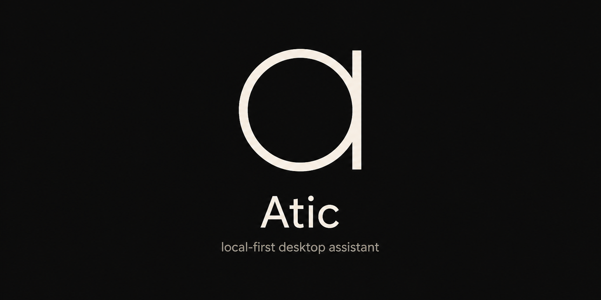
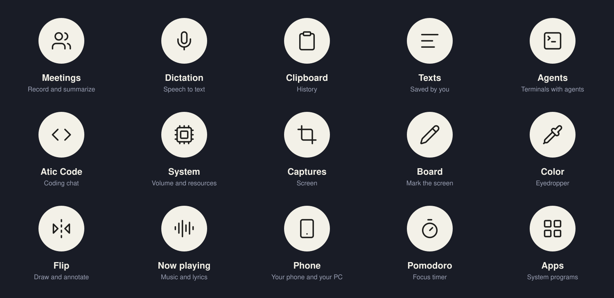

<p align="center">
  
</p>

<p align="center">
  A local-first desktop toolbox.<br>
  It lives in a floating <strong>pill</strong> — not in a window you have to go find.
</p>

<p align="center">
  <a href="README.md">Español</a> · <strong>English</strong>
</p>

<p align="center">
  <a href="LICENSE"></a>
  <a href="https://github.com/chrx3/atic/releases/latest"></a>
  
  
  
</p>

Atic floats on top of your desktop: a pill that clings to the screen edge like
an island (on a Mac, to the notch) and opens a wheel of tools. Talk to the CLI
agents you already have installed, launch apps, dictate, record meetings,
capture and paste — without leaving what you were doing.

It is not another chat window or an index of your whole disk. It is the tools
of your OS and your CLIs, in a presence that stays out of the way.

<p align="center">
  
  
</p>

Audio is recorded on your machine, and Whisper transcribes locally. If you
choose Groq for dictation or live transcription, that audio does go to its API.
Summaries are BYOK: only text travels, with your key in the system keychain.

Atic is **open source** ([MIT](LICENSE)). Development happens on
[`main`](https://github.com/chrx3/atic). Issues and PRs are welcome.

## What it does

<p align="center">
  
</p>

| | |
|---|---|
| **Agents and Atic Code** | Claude Code, Codex, Cursor and OpenCode in a console with a real interface. Atic doesn't authenticate: it hooks into the CLI you already logged in to. Atic Code is a workspace with folders, panels, changes and a web preview. |
| **Meetings** | Mic + system audio on separate tracks, local transcription (with live captions), an editable summary, sending by email. Call detection only *suggests* recording. |
| **Dictation** | Global shortcut (toggle or push-to-talk). Transcribes and pastes where you were typing. |
| **Captures** | Window, region or monitor, to the clipboard and a floating shelf. Records the screen and, on Mac, edits and exports it. **Copy text** (OCR) picks the text out of an image column by column, like Circle to Search. |
| **Board and Flip** | The Board freezes the screen and you mark it right where it is (arrows, circles, strokes). Flip is a canvas to draw, write and make checklists. What you draw can be sent to an agent. |
| **Clipboard and Texts** | A local history of text and images (it never archives what a password manager marked as ephemeral) and, separately, the texts you saved by hand. |
| **Phone** | Pair your Android with a QR code: files, notifications, calls, clipboard, touch control, and each screen on the other. No accounts, no cloud. |
| **Apps, System and more** | A Spotlight-style launcher with emoji, volume and resources, Color (eyedropper), Now playing (with synced lyrics) and Pomodoro. |

Each one, with its shortcuts and the differences between Windows and macOS:
[`docs/TOOLS.md`](docs/TOOLS.md). A living catalog of capabilities (done, in
progress and ideas): [`Features/`](Features/) (in Spanish).

## Built with GPUI

Atic is pure Rust with [GPUI](https://crates.io/crates/gpui), the UI framework
that renders on the GPU and was born in the Zed editor. It left Tauri and the
web behind: the pill, the notch, and the Settings, Meetings, Atic Code, Flip and
Board windows are all GPUI components, with one native layer per OS
(`platform/win32` and `platform/macos`) and three window styles: Atic,
Material 3 Expressive and Liquid Glass.

What GPUI is, why the app migrated and how it is put together:
[`docs/GPUI.en.md`](docs/GPUI.en.md).

## What's new

The latest version is **0.5.6**:

- Captures has a bar to switch between Capture and Record.
- On Mac, the recording editor: autofocus on your clicks, backgrounds, text, cuts and an assistant powered by your agent; export as vertical, square, 4:5, GIF or HEVC, with automatic local captions.
- Live captions in Meetings with the local model, no internet or key needed.
- Copy text now separates columns, and notifications you can't reply to put "Dismiss" at the end of the row.

Every version, from 0.2.0 to today: [`CHANGELOG.en.md`](CHANGELOG.en.md).

## Install

Download the latest installer from
[Releases](https://github.com/chrx3/atic/releases/latest):

- **Windows:** `*-setup.exe` (NSIS). SmartScreen may warn you: the app doesn't carry an Authenticode signature yet.
- **macOS:** `Atic_<version>_universal.dmg` (Apple Silicon and Intel). The app isn't notarized: the first time, right-click → **Open**
  ([`docs/MACOS.md`](docs/MACOS.md), in Spanish: permissions and local signing).

Whisper models download on first use; they aren't bundled in the installer.
Atic updates itself from its What's new window.

## Using it

1. The pill always stays on top. Click it to open the tool wheel.
2. Recording, dictation, capture, agents, the board and the launcher have their own global shortcuts.
3. **Summoning the pill** to the cursor and opening the wheel from the keyboard have no default shortcut: you pick them in Settings.
4. Meetings, Settings and Atic Code open in their own window.

Default shortcuts (all of them can be changed in Settings):

| Tool | Windows | macOS |
|---|---|---|
| Record / stop | `Alt+R` | `⌘⇧R` |
| Dictation | `Alt+D` | `⌘⇧D` |
| Clipboard | `Alt+V` | `⌘⇧V` |
| Texts | `Alt+Shift+V` | `⌘⌃V` |
| Agents | `Alt+A` | `⌘⇧A` |
| Capture | `Alt+S` | `⌘⇧S` |
| Board | `Alt+X` | `⌘⇧X` |
| Color | `Alt+C` | `⌘⇧C` |
| Flip | `Alt+B` | `⌘⇧B` |
| Launcher | `Alt+Shift+Space` | `⌘⇧Space` |

Recording other people may require consent depending on your country. Atic
**never** records on its own: it takes an action from you. Call detection does
not press the button.

## Privacy

- Recordings, transcripts, clipboard, agent conversations and logs live on your
  local disk (`%APPDATA%\ciat\atic\data\` on Windows;
  `~/Library/Application Support/com.ciat.atic/` on Mac).
- API keys (Groq, Claude, OpenAI, …) and the SMTP password go to the **system
  keychain**, not to `config.json`.
- Atic doesn't authenticate agents: it uses the CLI you already installed and
  logged in to.
- There is no Atic account and no product telemetry.

## Development

The app lives in `apps/atic`. To build and test it:

```bash
git clone https://github.com/chrx3/atic.git
cd atic

# Windows: builds in dev mode, closes any running Atic and opens the new one
powershell -File scripts/pill-dev.ps1
powershell -File scripts/pill-dev.ps1 -Watch   # rebuilds and reopens on save

# macOS: builds, assembles and signs "Atic Pill.app" and opens it
bash scripts/pill-dev-mac.sh
bash scripts/pill-dev-mac.sh --watch
```

The app uses the Material 3 components from [`gpui-m3`](https://github.com/chrx3/gpui-m3),
which is cloned **next to** `atic` (`../gpui-m3`). What GPUI is and how the app
is organized: [`docs/GPUI.en.md`](docs/GPUI.en.md). On Mac, also:
[`docs/MACOS_GPUI.md`](docs/MACOS_GPUI.md) and [`docs/MACOS.md`](docs/MACOS.md)
(in Spanish). Working rules and a map of the repo: [`AGENTS.md`](AGENTS.md).
Documentation index: [`docs/README.md`](docs/README.md).

Branch from `main`, open PRs against `main`. How to contribute:
[`CONTRIBUTING.md`](CONTRIBUTING.md).
Vulnerabilities: [`SECURITY.md`](SECURITY.md).
Community: [`CODE_OF_CONDUCT.md`](CODE_OF_CONDUCT.md).

## License

[MIT](LICENSE) · copyright [chrx3](https://github.com/chrx3).
Contributing means accepting that license.
