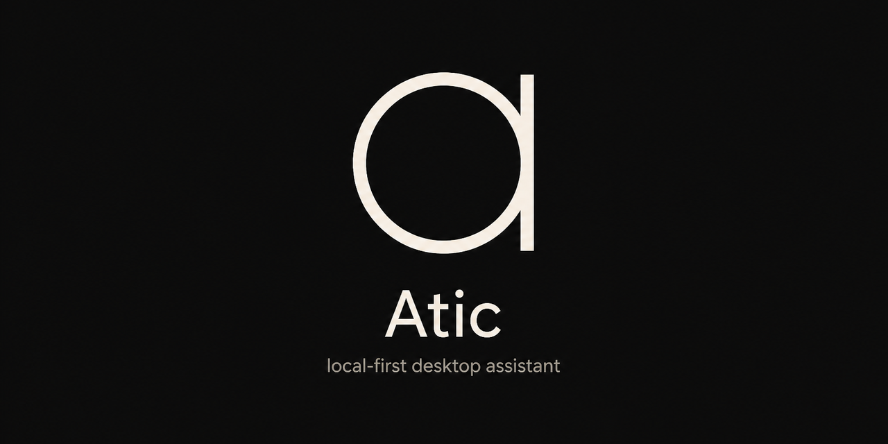
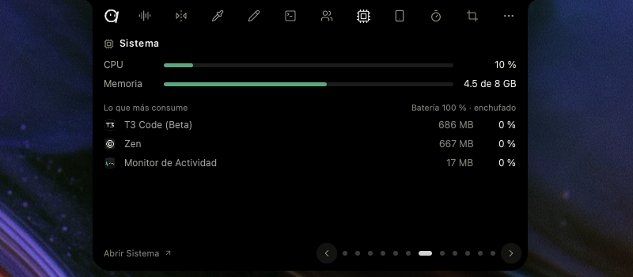
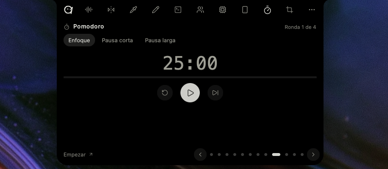
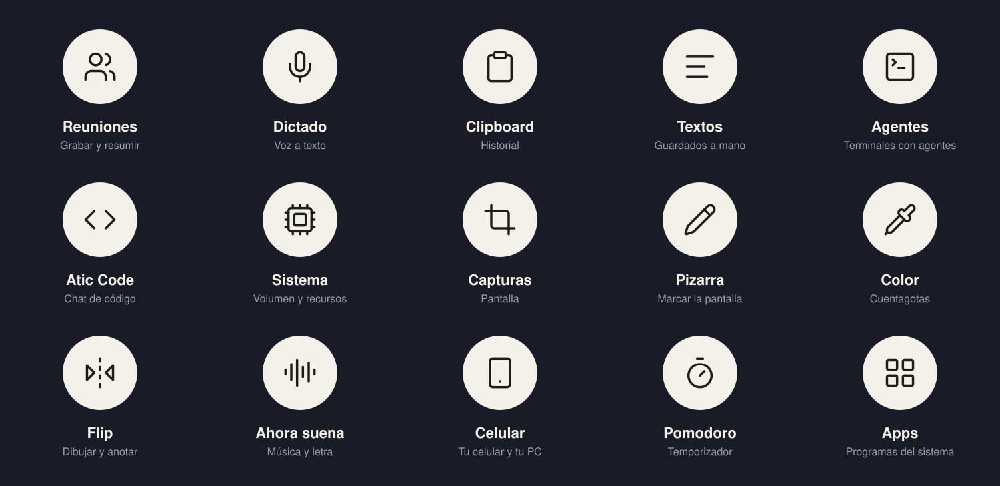
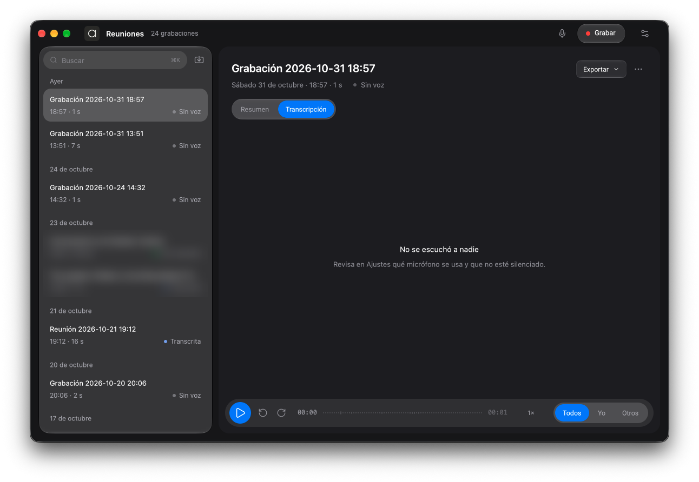
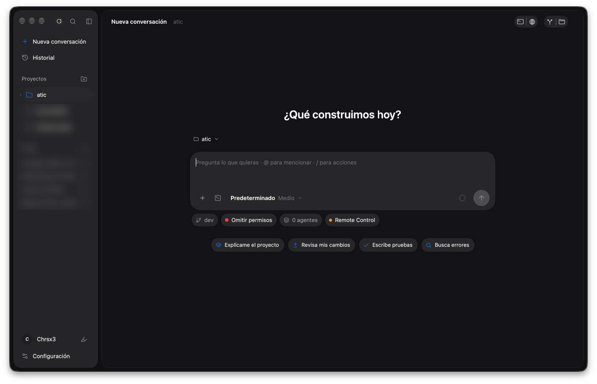
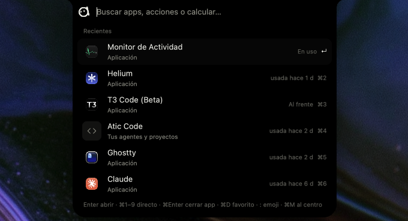
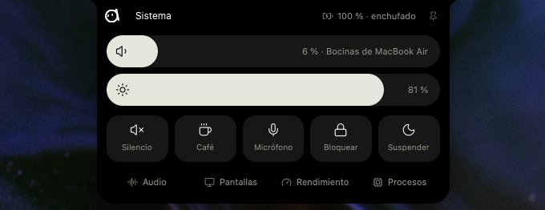
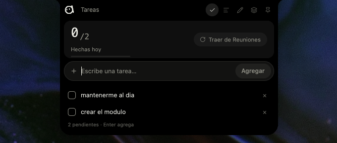
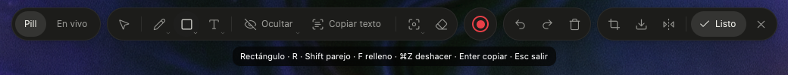

<p align="center">
  
</p>

<p align="center">
  Caja de herramientas de escritorio local-first.<br>
  Vive en una <strong>pill</strong> flotante — no en una ventana que hay que ir a buscar.
</p>

<p align="center">
  <strong>Español</strong> · <a href="README.en.md">English</a>
</p>

<p align="center">
  <a href="LICENSE"></a>
  <a href="https://github.com/chrx3/atic/releases/latest"></a>
  
  
  
</p>

Atic flota encima del escritorio: una pill que se pega al borde como una isla
(en Mac, al notch) y abre una rueda con las herramientas. Conversas con los
agentes CLI que ya tienes instalados, lanzas apps, dictas, grabas reuniones,
capturas y pegas — sin salir de lo que estabas haciendo.

No es otra ventana de chat ni un índice de todo el disco. Son las herramientas
del SO y de tus CLIs, en una presencia que no interrumpe.

<p align="center">
  
  
</p>

El audio se graba en tu equipo; Whisper transcribe en local. Si eliges Groq
para dictado o transcripción en vivo, ese audio sí sale a su API. Los
resúmenes son BYOK: solo viaja el texto, con la clave en el llavero del
sistema.

Atic es **open source** ([MIT](LICENSE)). El desarrollo vive en
[`main`](https://github.com/chrx3/atic). Issues y PRs son bienvenidos.

## Qué hace

<p align="center">
  
</p>

| | |
|---|---|
| **Agentes y Atic Code** | Claude Code, Codex, Cursor y OpenCode en una consola con interfaz. Atic no autentica: se cuelga del CLI que ya logueaste. Atic Code es un espacio de trabajo con carpetas, paneles, cambios y vista previa web. |
| **Reuniones** | Mic + sistema en pistas separadas, transcripción local (con subtítulos en vivo), resumen editable, envío por correo. La detección de llamadas solo *sugiere* grabar. |
| **Dictado** | Atajo global (toggle o push-to-talk). Transcribe y pega donde estabas escribiendo. |
| **Capturas** | Ventana, región o monitor, al portapapeles y a un shelf flotante. Graba la pantalla y, en Mac, la edita y exporta. **Copiar texto** (OCR) elige el texto de una imagen por columnas, como Circle to Search. |
| **Pizarra y Flip** | La Pizarra congela la pantalla y la marcas ahí donde está (flechas, círculos, trazo). Flip es un lienzo para dibujar, escribir y hacer checklists. Lo dibujado se puede enviar a un agente. |
| **Clipboard y Textos** | Historial local de texto e imágenes (no archiva lo que un gestor de contraseñas marcó como efímero) y, aparte, tus textos guardados a mano. |
| **Celular** | Empareja tu Android con un QR: archivos, avisos, llamadas, portapapeles, control táctil y la pantalla de uno en el otro. Sin cuentas ni nube. |
| **Apps, Sistema y más** | Launcher tipo Spotlight con emoji, volumen y recursos, Color (cuentagotas), Ahora suena (con letra sincronizada) y Pomodoro. |

Cada una, con sus atajos y diferencias entre Windows y macOS:
[`docs/HERRAMIENTAS.md`](docs/HERRAMIENTAS.md). Catálogo vivo de capacidades
(hechas, a medias e ideas): [`Features/`](Features/).

## Cómo se ve

<p align="center">
  
  
</p>

<p align="center">
  
  
  
</p>

<p align="center">
  
</p>

## Hecho con GPUI

Atic es Rust puro con [GPUI](https://crates.io/crates/gpui), el framework de
interfaz que dibuja en la GPU y que nació en el editor Zed. Dejó atrás a Tauri
y a la web: la pill, el notch, las ventanas de Ajustes, Reuniones, Atic Code,
Flip y la Pizarra son componentes GPUI, con una capa nativa por sistema
(`platform/win32` y `platform/macos`) y tres estilos de ventana: Atic,
Material 3 Expressive y Liquid Glass.

Qué es GPUI, por qué se migró y cómo está armada la app:
[`docs/GPUI.md`](docs/GPUI.md).

## Novedades

La última versión es la **0.5.6**:

- Capturas tiene una barra para cambiar entre Captura y Grabar.
- En Mac, el editor de grabaciones: autofocus en tus clics, fondos, textos, cortes y un asistente con tu agente; exporta en vertical, cuadrado, 4:5, GIF o HEVC, con subtítulos automáticos locales.
- Subtítulos en vivo en Reuniones con el modelo local, sin internet ni llave.
- Copiar texto separa por columnas, y los avisos sin respuesta llevan «Descartar» al final de la fila.

Todas las versiones, de la 0.2.0 a hoy: [`CHANGELOG.md`](CHANGELOG.md).

## Instalar

Descarga el último instalador en
[Releases](https://github.com/chrx3/atic/releases/latest):

- **Windows:** `*-setup.exe` (NSIS). Puede mostrar SmartScreen: la app todavía no lleva firma Authenticode.
- **macOS:** `Atic_<versión>_universal.dmg` (Apple Silicon e Intel). La app no está notarizada: la primera vez, clic derecho → **Abrir**
  ([`docs/MACOS.md`](docs/MACOS.md): permisos y firma local).

Los modelos de Whisper se bajan en el primer uso; no van dentro del instalador.
Atic se actualiza sola desde sus Novedades.

## Uso

1. La pill queda siempre encima. Clic sobre ella abre la rueda de herramientas.
2. Grabar, dictar, capturar, agentes, la pizarra y el launcher tienen atajos globales propios.
3. **Traer la pill** al cursor y abrir la rueda con el teclado no traen atajo de fábrica: los eliges en Ajustes.
4. Reuniones, Ajustes y Atic Code se abren en su propia ventana.

Atajos por defecto (en Ajustes se cambian todos):

| Herramienta | Windows | macOS |
|---|---|---|
| Grabar / detener | `Alt+R` | `⌘⇧R` |
| Dictado | `Alt+D` | `⌘⇧D` |
| Clipboard | `Alt+V` | `⌘⇧V` |
| Textos | `Alt+Shift+V` | `⌘⌃V` |
| Agentes | `Alt+A` | `⌘⇧A` |
| Captura | `Alt+S` | `⌘⇧S` |
| Pizarra | `Alt+X` | `⌘⇧X` |
| Color | `Alt+C` | `⌘⇧C` |
| Flip | `Alt+B` | `⌘⇧B` |
| Launcher | `Alt+Shift+Space` | `⌘⇧Space` |

Grabar a otras personas puede requerir consentimiento según el país. Atic
**nunca** graba solo: hace falta una acción tuya. La detección de llamadas no
aprieta el botón.

## Privacidad

- Grabaciones, transcripts, clipboard, conversaciones de agentes y logs viven
  en el disco local (`%APPDATA%\ciat\atic\data\` en Windows;
  `~/Library/Application Support/com.ciat.atic/` en Mac).
- Las API keys (Groq, Claude, OpenAI, …) y la contraseña SMTP van al **llavero
  del sistema**, no a `config.json`.
- Atic no autentica agentes: usa el CLI que tú ya instalaste y logueaste.
- No hay cuenta Atic ni telemetría de producto.

## Desarrollo

La app está en `apps/atic`. Para compilarla y probarla:

```bash
git clone https://github.com/chrx3/atic.git
cd atic

# Windows: compila en modo dev, cierra la Atic que esté abierta y abre la nueva
powershell -File scripts/pill-dev.ps1
powershell -File scripts/pill-dev.ps1 -Watch   # recompila y reabre al guardar

# macOS: compila, arma y firma «Atic Pill.app» y la abre
bash scripts/pill-dev-mac.sh
bash scripts/pill-dev-mac.sh --watch
```

La app usa los componentes Material 3 de [`gpui-m3`](https://github.com/chrx3/gpui-m3),
que va clonado **al lado** de `atic` (`../gpui-m3`). Qué es GPUI y cómo está
armada la app: [`docs/GPUI.md`](docs/GPUI.md). En Mac, además:
[`docs/MACOS_GPUI.md`](docs/MACOS_GPUI.md) y [`docs/MACOS.md`](docs/MACOS.md).
Reglas de trabajo y mapa del repo: [`AGENTS.md`](AGENTS.md). Índice de la
documentación: [`docs/README.md`](docs/README.md).

Ramas desde `main`, PRs hacia `main`. Cómo contribuir:
[`CONTRIBUTING.md`](CONTRIBUTING.md).
Vulnerabilidades: [`SECURITY.md`](SECURITY.md).
Comunidad: [`CODE_OF_CONDUCT.md`](CODE_OF_CONDUCT.md).

## Licencia

[MIT](LICENSE) · copyright [chrx3](https://github.com/chrx3).
Contribuir implica aceptar esa licencia.
