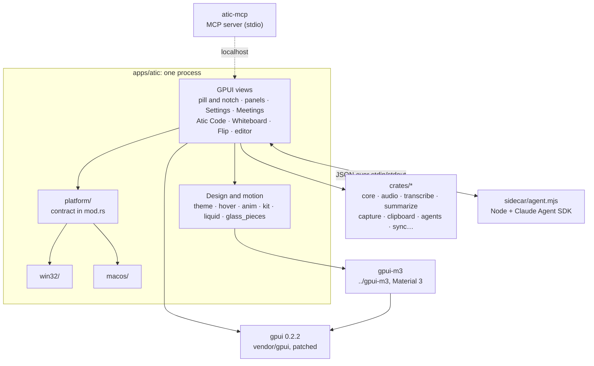
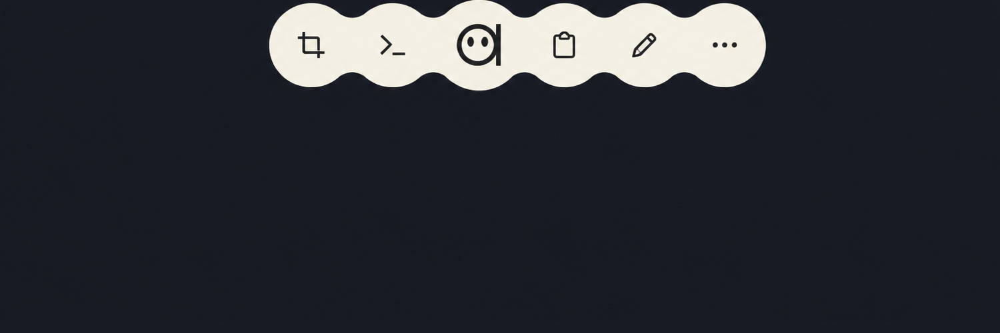

# GPUI and how Atic uses it

Español: [GPUI.md](GPUI.md)

Atic is a desktop toolbox that floats over your desktop as a "pill". Since
October 2026 it is written in pure Rust with [GPUI](https://www.gpui.rs), the
UI framework behind the Zed editor. This document explains what GPUI is, why
Atic left Tauri and Svelte, and how the app is put together. If you are just
curious, read sections 1 to 3; if you plan to touch the code, keep going.

<p align="center"></p>

## 1. What GPUI is

GPUI is the UI framework Zed Industries wrote for the Zed editor. It is
published as the `gpui` crate (Apache-2.0). Its README calls it a "hybrid
immediate and retained mode, GPU accelerated, UI framework", and it is still
pre-1.0: expect breaking changes between versions.

What sets it apart from a web UI or a native toolkit:

- **It draws everything on the GPU.** No DOM, no system widgets. It uses Metal
  on macOS and DirectX on Windows (there is also a Linux backend, which Atic
  does not use). GPUI calls `render`, builds the element tree and turns it
  into pixels.
- **Three levels of work**, per the README:
  - **Entities** (`Entity<T>`): application state. GPUI owns them and you reach
    them through a context (`App`, `Window`, `Context<T>`).
  - **Views**: an entity that implements `Render`. Its `render` method builds
    an element tree with a Tailwind-style API (`div().flex().gap(px(8.))`).
  - **Elements**: the low-level imperative layer, for huge lists, custom layout
    or custom drawing.
- **Shortcuts as actions**: you declare them and a keymap binds keys to them.
- **Repainting is explicit**: a view calls `cx.notify()` when its state
  changed. When nothing changes, it costs nothing.

GPUI ships no component catalog and no native controls. Everything you see in
Atic (buttons, text fields, menus, terminals, lists) is built by Atic or by
[`gpui-m3`](#5-gpui-m3-and-the-three-window-styles). It has no perspective
transforms either: the 3D turn of Flip is faked with vertical strips of the
screenshot (`apps/atic/src/flip.rs`).

### Which GPUI Atic uses

- `gpui = "0.2.2"` (crates.io), declared in `apps/atic/Cargo.toml`.
- A **vendored copy** in `apps/atic/vendor/gpui`, enabled through
  `[patch.crates-io]`. It applies to the whole dependency graph, `gpui-m3`
  included.
- The copy carries a few patches, with the reason for each in
  [`apps/atic/vendor/PATCHES.md`](../apps/atic/vendor/PATCHES.md) (exact diff in
  `vendor/gpui.patch`): focus and transparent-window fixes on macOS, less GPU
  memory for the pill's canvas, and a hook to change colors live while
  developing (`src/tweak.rs`).
- On macOS, `runtime_shaders` is on: Xcode 26 no longer ships the Metal
  compiler, so shaders are compiled at launch.

## 2. Why Atic left Tauri

The first version of Atic (the repo's first commit is from 2026-07-19) was a
**Tauri and Svelte** app: a Rust backend with the UI in the system web view
(WebView2 on Windows). The floating pill was an always-visible web overlay.
What the repo's documents say about the change:

- **The stated goal was to get rid of WebView2.** The plan
  ([`PLAN_MIGRACION_GPUI.md`](PLAN_MIGRACION_GPUI.md), 2026-10-06; in Spanish)
  starts with the pill and its tools because the overlay is "always visible and
  redrawing", and ends with removing Tauri.
  [`PROGRESO_GPUI.md`](PROGRESO_GPUI.md) records 2026-10-08 as the day WebView2
  stopped showing up in everyday use on Windows.
- **The logic was already Rust.** Most of the backend (agents, clipboard,
  system control, calculator) did not depend on Tauri and moved into
  `crates/` without a rewrite. The UI was what had to be redone.
- **Fewer middlemen on the heavy paths.** According to code comments, the
  capture crosshair used to be a web view loading a JPEG written to disk; now the
  frame goes straight into a texture. The whiteboard keeps the screenshot as a
  texture and only builds the strokes each frame.
  [`RENDIMIENTO_PIZARRA_AGENTES.md`](RENDIMIENTO_PIZARRA_AGENTES.md) lists
  browser-specific costs on the web agents board (backdrop blur, WebGL
  layers), though it notes the slowness could not be reproduced.
- **Smoothness and memory.** The 0.4.50 changelog says "Windows is smoother and
  uses less memory".

The price: GPUI "is young and its API changes" (a risk noted in the plan), so
the version is pinned and vendored; you have to build what the browser gave
you for free (components, selectable text, terminals, diffs); and each
platform needs its own native layer. One honest detail: Atic Code's **web
preview** does use the system web view, through `wry` (`code/preview.rs`),
inside a GPUI window.

| Date | Milestone (changelog and git history) |
| --- | --- |
| 2026-07-19 | First commit and v0.2.0: Atic on Tauri and Svelte |
| 2026-09-13 | 0.4.35: Atic reaches macOS (still on Tauri) |
| 2026-10-02 | First GPUI prototype of the pill |
| 2026-10-10 | 0.4.46: "Atic now runs as the native pill"; Atic Code arrives |
| 2026-10-17 | 0.4.49: Atic for macOS runs on the GPUI pill, with physical-notch support |
| 2026-10-24 | 0.5.0: Settings and Meetings in Material 3 Expressive and Liquid Glass (macOS 26); the whole app in English |
| 2026-10-31 | Tauri is removed from the repo; the app lives in `apps/atic` (0.5.5) |

## 3. How the app is put together

It is **a single process** (`pill-gpui`; installed as `atic-pill.exe` on
Windows and as `Atic.app` on macOS): over 160 thousand lines of Rust in
`apps/atic/src`, with its own workspace and `Cargo.lock`, separate from the
`crates/` workspace.



### The pill and its panels

The app opens **one transparent window that covers the monitor**
(`WindowKind::PopUp`, no focus, no title bar). The pill moves inside it and,
outside the pill, clicks pass through to the apps underneath. This is how it
starts, in `apps/atic/src/main.rs` (the comments are in Spanish):

```rust
        // Una sola ventana transparente que cubre el monitor: la pill se mueve
        // dentro, como en Atic, y fuera de ella los clics la atraviesan.
        let options = WindowOptions {
            window_bounds: Some(WindowBounds::Windowed(screen)),
            titlebar: None,
            focus: false,
            show: true,
            kind: WindowKind::PopUp,
            // …
            window_background: WindowBackgroundAppearance::Transparent,
            ..Default::default()
        };
```

The pill is one object that changes shape: docked to an edge it is a *tab* (the
"notch"), floating it is a capsule, and invoking it opens the tool **wheel**.
Tools with a panel (Clipboard, Texts, Apps, Agents, System, Now Playing) do not
open separate cards: the notch stretches to their size. Full-screen modes (the
Capture crosshair, the Whiteboard, the color picker, Flip) are drawn in that
same window.

<p align="center"></p>

### Regular windows

Separate windows, for focused work:

| Window | Where |
| --- | --- |
| Settings | `settings.rs` and the `*_settings.rs` panes |
| Meetings (record, transcribe, summarize) | `meetings/` |
| Atic Code (workspaces with agents, terminals, files, git, web preview) | `code/` and `kit/` |
| Recording editor (macOS for now) | `recording_editor/` |

### The `platform/` layer

Everything that depends on the operating system lives in
`apps/atic/src/platform/`. The contract is documented in `platform/mod.rs`:
`win32/` and `macos/` have the **same modules with the same public
functions**, and `mod.rs` picks one with `cfg`. The rest of the app uses them
as `crate::win`, `crate::paste`, and so on.

| Module | What it does |
| --- | --- |
| `win` | Always-on-top overlay that never steals focus, click-through, hiding from screenshots, monitors |
| `glass` | Frosted glass behind the pill |
| `paste` | Paste into the target app (on Mac, Cmd+V through `CGEvent`) |
| `hotkeys` | Global shortcuts from `config.json` |
| `drag`, `ocr`, `privacy`, `running` | Drag to other apps, OCR, who is using the mic or camera, open apps |
| `autostart`, `tray_icon`, `screen_record` | Launch at login, tray or menu bar icon, screen recording |

On macOS it uses AppKit through `objc2` (an `NSPanel` for the overlay,
`NSVisualEffectView`, Vision, ScreenCaptureKit) and a Swift helper
(`atic-apple`) for macOS speech and Apple Intelligence; on Windows, Win32 and
WinRT. Per-piece status is in [`MACOS_GPUI.md`](MACOS_GPUI.md) (Spanish).

### Shared crates

UI-free logic, in the root workspace (`crates/`):

| Crate | What for |
| --- | --- |
| `core` | Configuration (`config.json`), keychain, data paths, SQLite |
| `audio` | Microphone and system audio (WASAPI, ScreenCaptureKit) to WAV |
| `transcribe`, `summarize`, `mailer` | Speech to text (local or Groq), AI summaries, email delivery |
| `capture` | Monitors and screenshots |
| `clipboard`, `calc` | Clipboard history; calculator and exchange rates |
| `agents`, `atic-mcp` | Hooks and permissions for CLI agents; MCP server over stdio |
| `sync`, `sign`, `atic-unix` | Encrypted channel to the phone (iroh); update signing; Unix commands for Windows consoles |

### Atic Code's agent

Atic Code does not reimplement an agent. `apps/atic/sidecar/agent.mjs` is an
always-running Node process with the Claude Agent SDK, which uses the `claude`
you already have installed (Atic stores no credentials). They talk with one
JSON line per message over stdin/stdout (`code/sidecar.rs`). OpenCode, Cursor
and Grok come in through ACP (`code/acp.rs`) and Codex through its own protocol
(`code/acp/codex.rs`); all of them are translated into the same events, so the
chat looks the same with any of them.

## 4. How it is drawn and animated

Colors, motion and hover each have a home of their own:

- **`theme.rs`**: named window colors (`WINDOW`, `SURFACE`, `TEXT`…), each with
  its light-theme pair. `theme::hsla` returns the right one for the current
  system theme. The pill and its floating panels stay dark: they have to read
  over any background.
- **`hover.rs`**: GPUI's `.hover()` changes style instantly.
  `hover_fx(id, |h| …)` hands you `h.t` (0 at rest, 1 under the cursor) and
  `h.press`, smoothed, so background, color or actions can fade. The state
  lives in the element and only asks for frames while it animates.
- **`anim.rs`**: CSS-style `cubic_bezier` curves (`ease_island` overshoots
  slightly), a `Tween` you can redirect mid-flight without jumps, and
  `segment()` to give each part of a choreography its own slice.
- **`liquid.rs` and `glide.rs`**: the pill's liquid silhouette (circles and
  "necks" in a single path, so antialiasing leaves no seams) and selection
  indicators that stretch as they move. `fonts.rs` picks Segoe UI on Windows
  and San Francisco on macOS.

Transition rules live in the
[`transiciones-fluidas`](../.claude/skills/transiciones-fluidas/SKILL.md) skill
(in Spanish). In short:

1. One owner per element at any moment: no two copies cross-fading, and a
   hand-off only when both copies are identical.
2. Progress comes from state, not from when something was drawn: opening
   halfway shows the right point and several views stay in sync.
3. Do not restart the entrances of something the view is still following; what
   stops being useful leaves first.
4. Shapes grow or shrink in one direction; clip containers, not lines of text.
5. Check the in-between frames, not only the first and the last.

Drawing little is part of the design too: [`POR_OPTIMIZAR.md`](POR_OPTIMIZAR.md)
lists what keeps the pill redrawing needlessly, and `PILL_FPS=1` writes frames
per second to `pill-salida.log`.

### What a component looks like

An Atic view is a struct that implements `Render`. This is the end of the
`render` of the What's New window (`apps/atic/src/whats_new.rs`, excerpt):
Tailwind-style styling, a background that depends on the window style and, last,
the Material 3 scope.

```rust
let close = cx.listener(|_, _: &ClickEvent, window, _| window.remove_window());
// …
let pieces = crate::glass_pieces::active_windows();
div()
    .size_full()
    .flex()
    .flex_col()
    .when(!pieces, |el| el.bg(crate::theme::window_bg()))
    .when(pieces, |el| {
        el.child(crate::glass_pieces::slot(crate::glass_pieces::Piece::Fill { radius: 0., color: crate::theme::window_bg() }))
    })
    .font_family(crate::theme::font())
    .text_color(hsla(TEXT))
    .child(top)
    .child(content)
    .child(footer)
    .child(crate::glass_pieces::commit(crate::theme::is_light()))
    .children(m3_scope)
```

## 5. gpui-m3 and the three window styles

[`gpui-m3`](https://github.com/chrx3/gpui-m3) is a separate repo, cloned next to
`atic` (the pill reaches it through the path `../../../gpui-m3`). It provides
**Material 3 Expressive** components for GPUI: shape morphing, spring motion,
ripples and dynamic color. It has its own gallery
(`cargo run --example gallery`). If you change `gpui-m3`, push that repo
together with `atic`.

Windows can be shown in three styles, chosen in Settings → Appearance
(`appearance::WindowStyle`):

| Style | What it is |
| --- | --- |
| **Atic** | The app's own warm palette (called Formal in Atic Code) |
| **Material 3 Expressive** | The `gpui-m3` components |
| **Liquid Glass** | On macOS 26, real system glass: one native glass per floating panel or control (`glass_pieces.rs`), underneath the GPUI view. On Windows 11, Acrylic or Mica (`code/backdrop.rs`) |

Every style works in light and dark. A practical rule: any window root view that
draws `gpui-m3` components calls `theme::scope_m3(cx)` in its `render` and adds
`.children(m3_scope)` at the end. `gpui-m3` keeps its theme in a global:
`scope_m3` sets it to the chosen style's scheme and, when the frame ends,
restores the previous one so Atic Code keeps its own (`apps/atic/src/theme.rs`;
with the "Atic" style it does nothing).

## 6. Building and testing

Building the pill takes 4 to 10 minutes and a lot of memory (the first build on
an 8 GB Mac, about 20): do not start two builds at once. You need stable Rust
and, on Mac, Xcode's command line tools. Clone `chrx3/atic` and `chrx3/gpui-m3`
into the same folder, side by side.

| | Windows | macOS |
| --- | --- | --- |
| Build and open | `powershell -File scripts/pill-dev.ps1` | `bash scripts/pill-dev-mac.sh` |
| Rebuild on save | `… pill-dev.ps1 -Watch` | `… pill-dev-mac.sh --watch` |
| Build folder | `%LOCALAPPDATA%\atic-gpui` | `~/Library/Caches/atic-gpui-target` |
| What it opens | `pill-gpui.exe` (the installed one is `atic-pill.exe`) | `Atic Pill.app`, signed with the identity in `~/.tauri/atic-signing-identity` |
| Log | `%APPDATA%\ciat\atic\data\logs\pill.<date>.log` | `~/Library/Application Support/com.ciat.atic/logs/pill.<date>.log` |

The pill's `cargo` commands take `--manifest-path apps/atic/Cargo.toml`.
Pill tests (under a second once built):

```powershell
cargo test --manifest-path apps/atic/Cargo.toml --target-dir "$env:LOCALAPPDATA\atic-gpui" <filter>
```

On Mac: `cd apps/atic && CARGO_TARGET_DIR=~/Library/Caches/atic-gpui-target cargo test -j 4 <filter>`.
Crates are tested with `cargo test --locked -p <crate> <filter>`. Atic Code's
agent is bundled with `pnpm --dir apps/atic/sidecar run build`.

Handy while developing:

- `apps/atic/tweaks.json` (git-ignored): the dev pill re-reads colors and
  numbers on save, no rebuild (`src/tweak.rs`).
- `PILL_OPEN=settings|meetings|novedades` opens a window at launch;
  `CODE_ALONE=1` opens only Atic Code.
- Do not run `cargo fmt` (the pill is not rustfmt-formatted). "It compiles",
  "the tests pass" and "it looks right in the app" are three different things.

## 7. Where to look in the code

| I want to understand… | Look at |
| --- | --- |
| Startup and the pill | `apps/atic/src/main.rs` (`main`, `impl Render for Pill`) |
| Colors, hover, curves | `theme.rs`, `hover.rs`, `anim.rs` |
| The liquid silhouette and per-piece glass | `liquid.rs`, `glass_pieces.rs` |
| Custom components (console, panes, explorer, viewer) | `kit/` |
| What differs per operating system | `platform/mod.rs`, `platform/win32/`, `platform/macos/` |
| Atic Code, its agent and styles | `code/`, `code/sidecar.rs`, `code/style.rs`, `sidecar/agent.mjs` |
| A specific tool | `capture.rs`, `board.rs`, `flip.rs`, `meetings/`, `clipboard.rs`, `launcher.rs` |
| The patched GPUI | `apps/atic/vendor/gpui`, `apps/atic/vendor/PATCHES.md` |
| Shared logic and Material 3 | `crates/*`, `../gpui-m3` (README and gallery) |

Internal documents (mostly in Spanish):

- [`AGENTS.md`](../AGENTS.md): working rules and repo map.
- [`MACOS_GPUI.md`](MACOS_GPUI.md): building on Mac, per-piece status and how to port.
- [`PLAN_MIGRACION_GPUI.md`](PLAN_MIGRACION_GPUI.md) and [`PROGRESO_GPUI.md`](PROGRESO_GPUI.md): the migration plan and progress (period notes, with paths from when Tauri existed).
- [`DISENO_PILL.md`](DISENO_PILL.md): the pill's visual contract. It dates from the Svelte era: its code paths are from then and, where something disagrees, the code wins.
- [`MIGRACION_REFERENCIA.md`](MIGRACION_REFERENCIA.md): the Atic Code port. Performance: [`POR_OPTIMIZAR.md`](POR_OPTIMIZAR.md).
