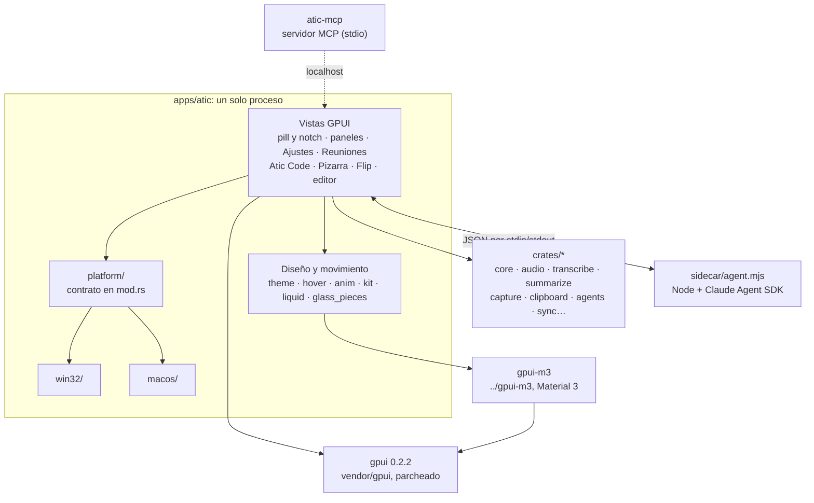
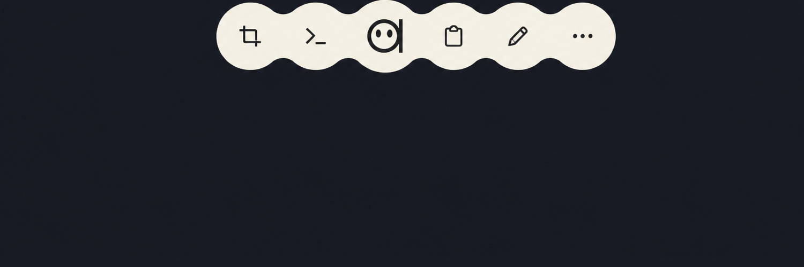

# GPUI y cómo Atic lo usa

English: [GPUI.en.md](GPUI.en.md)

Atic es una caja de herramientas de escritorio que flota sobre el escritorio
como una «pill». Desde octubre de 2026 está escrita en Rust puro con
[GPUI](https://www.gpui.rs), el framework de interfaz de Zed. Aquí se explica
qué es GPUI, por qué Atic dejó Tauri y Svelte, y cómo está armada la app. Si
solo tienes curiosidad, lee las secciones 1 a 3; para tocar código, sigue.

<p align="center"></p>

## 1. Qué es GPUI

GPUI es el framework de interfaz que Zed Industries escribió para el editor
Zed. Se publica como el crate `gpui` (Apache-2.0). Su README lo define como un
framework «híbrido de modo inmediato y retenido, acelerado por GPU», y sigue
siendo pre-1.0: cambia entre versiones.

Lo que lo distingue de una interfaz web o de un toolkit nativo:

- **Dibuja todo en la GPU.** No hay DOM ni widgets del sistema. Usa Metal en
  macOS y DirectX en Windows (hay también un backend para Linux, que Atic no
  usa). GPUI llama a `render`, arma el árbol y lo convierte en pixeles.
- **Tres niveles de trabajo**, según el README:
  - **Entidades** (`Entity<T>`): el estado de la aplicación. Son propiedad de
    GPUI y se acceden con un contexto (`App`, `Window`, `Context<T>`).
  - **Vistas**: una entidad que implementa `Render`. Su método `render` arma un
    árbol de elementos con una API de estilo tipo Tailwind (`div().flex().gap(px(8.))`).
  - **Elementos**: la capa imperativa de bajo nivel, para listas enormes,
    layouts propios o dibujo a medida.
- **Atajos como acciones**: se declaran y un mapa de teclas las enlaza.
- **Repintar es explícito**: una vista llama a `cx.notify()` cuando su estado
  cambió. Quieta, no cuesta nada.

GPUI no trae un catálogo de componentes ni controles nativos. Todo lo que ves
en Atic (botones, campos, menús, terminales, listas) lo arma Atic o
[`gpui-m3`](#5-gpui-m3-y-los-tres-estilos-de-ventana). Tampoco trae
transformaciones con perspectiva: el giro 3D del Flip se simula con tiras
verticales de la captura (`apps/atic/src/flip.rs`).

### Qué versión usa Atic

- `gpui = "0.2.2"` (crates.io), declarado en `apps/atic/Cargo.toml`.
- Una **copia vendorizada** en `apps/atic/vendor/gpui`, activada con
  `[patch.crates-io]`. Vale para todo el grafo, también para `gpui-m3`.
- La copia lleva unos pocos parches, con su motivo en
  [`apps/atic/vendor/PATCHES.md`](../apps/atic/vendor/PATCHES.md) (diff exacto
  en `vendor/gpui.patch`): arreglos de foco y ventanas transparentes en macOS,
  menos memoria gráfica para el lienzo de la pill y un gancho para cambiar
  colores en vivo al desarrollar (`src/tweak.rs`).
- En macOS se activa `runtime_shaders`: Xcode 26 ya no trae el compilador de
  Metal, así que los shaders se compilan al arrancar.

## 2. Por qué Atic dejó Tauri

La primera versión de Atic (el primer commit del repo es del 2026-07-19) era
una app de **Tauri con Svelte**: backend en Rust e interfaz en la vista web del
sistema (WebView2 en Windows). La pill flotante era un overlay web siempre
visible. Lo que dicen los documentos del repo sobre el cambio:

- **El objetivo declarado fue sacar WebView2.** El plan
  ([`PLAN_MIGRACION_GPUI.md`](PLAN_MIGRACION_GPUI.md), 2026-10-06) empieza por
  la pill y sus herramientas porque el overlay «está siempre visible y
  redibujando», y termina con el retiro de Tauri.
  [`PROGRESO_GPUI.md`](PROGRESO_GPUI.md) anota el 2026-10-08 como el día en que,
  en el uso diario en Windows, WebView2 dejó de aparecer.
- **La lógica ya era Rust.** Casi todo el backend (agentes, portapapeles,
  control del sistema, calculadora) no dependía de Tauri y pasó a `crates/`
  sin reescribirse. Lo que había que rehacer era la interfaz.
- **Menos intermediarios en lo pesado.** Según los comentarios del código, la
  mira de Capturas era un WebView que cargaba un JPEG escrito a disco; ahora el
  cuadro va directo a una textura. La Pizarra guarda la foto como textura y solo
  arma los trazos en cada cuadro.
  [`RENDIMIENTO_PIZARRA_AGENTES.md`](RENDIMIENTO_PIZARRA_AGENTES.md) lista
  costos propios del navegador en la pizarra de agentes web (desenfoque de
  fondo, capas WebGL), aunque anota que no pudo reproducir la lentitud.
- **Fluidez y memoria.** El changelog de 0.4.50 dice «Windows va más fluido y
  con menos memoria».

Lo que se paga: GPUI «es joven y su API cambia» (riesgo anotado en el plan),
por eso se fija y se vendoriza; hay que construir lo que el navegador daba
gratis (componentes, texto seleccionable, terminales, diffs); y cada plataforma
pide su capa nativa. Un detalle honesto: la **vista previa web de Atic Code**
sí usa la vista web del sistema, con `wry` (`code/preview.rs`), dentro de una
ventana GPUI.

| Fecha | Hito (changelog e historial de git) |
| --- | --- |
| 2026-07-19 | Primer commit y v0.2.0: Atic en Tauri y Svelte |
| 2026-09-13 | 0.4.35: Atic llega a macOS (todavía con Tauri) |
| 2026-10-02 | Primer prototipo de la pill en GPUI |
| 2026-10-10 | 0.4.46: «Atic corre ahora como la pill nativa»; llega Atic Code |
| 2026-10-17 | 0.4.49: Atic de macOS corre con la pill GPUI, con notch físico |
| 2026-10-24 | 0.5.0: Ajustes y Reuniones en Material 3 Expressive y Liquid Glass (macOS 26); toda la app en inglés |
| 2026-10-31 | Se elimina Tauri del repo; la app queda en `apps/atic` (0.5.5) |

## 3. Cómo está armada la app

Es **un solo proceso** (`pill-gpui`; en Windows se instala como `atic-pill.exe`,
en macOS como `Atic.app`): más de 160 mil líneas de Rust en `apps/atic/src`,
con su propio workspace y `Cargo.lock`, aparte del workspace de `crates/`.



### La pill y sus paneles

La app abre **una ventana transparente que cubre el monitor** (`WindowKind::PopUp`,
sin foco, sin barra). La pill se mueve dentro de ella y, fuera de la pill, los
clics atraviesan la ventana hacia las apps de abajo. Así sale este arranque en
`apps/atic/src/main.rs`:

```rust
        // Una sola ventana transparente que cubre el monitor: la pill se mueve
        // dentro, como en Atic, y fuera de ella los clics la atraviesan.
        let options = WindowOptions {
            window_bounds: Some(WindowBounds::Windowed(screen)),
            titlebar: None,
            focus: false,
            show: true,
            kind: WindowKind::PopUp,
            // …
            window_background: WindowBackgroundAppearance::Transparent,
            ..Default::default()
        };
```

La pill es un solo objeto que cambia de forma: pegada a un borde es un *tab*
(el «notch»), flotando es una cápsula, y al invocarla abre la **rueda** de
herramientas. Las herramientas con panel (Clipboard, Textos, Apps, Agentes,
Sistema, Ahora suena) no abren tarjetas aparte: el notch se estira hasta su
tamaño. Las pantallas completas (la mira de Capturas, la Pizarra, el
cuentagotas, el Flip) se dibujan en esa misma ventana.

<p align="center"></p>

### Ventanas normales

Ventanas aparte, para trabajar con calma:

| Ventana | Dónde |
| --- | --- |
| Ajustes | `settings.rs` y los paneles `*_settings.rs` |
| Reuniones (grabar, transcribir, resumir) | `meetings/` |
| Atic Code (espacios con agentes, terminales, archivos, git, vista previa web) | `code/` y `kit/` |
| Editor de grabaciones (hoy en macOS) | `recording_editor/` |

### La capa `platform/`

Todo lo que depende del sistema operativo vive en `apps/atic/src/platform/`.
El contrato está documentado en `platform/mod.rs`: `win32/` y `macos/` tienen
los **mismos módulos con las mismas funciones públicas**, y `mod.rs` elige uno
con `cfg`. El resto de la app los usa como `crate::win`, `crate::paste`, etc.

| Módulo | Qué hace |
| --- | --- |
| `win` | Overlay siempre encima sin robar foco, clics que atraviesan, ocultarse de las capturas, monitores |
| `glass` | Vidrio esmerilado detrás de la pill |
| `paste` | Pegar en la app de destino (en Mac, Cmd+V por `CGEvent`) |
| `hotkeys` | Atajos globales de `config.json` |
| `drag`, `ocr`, `privacy`, `running` | Arrastrar a otras apps, OCR, quién usa micrófono o cámara, apps abiertas |
| `autostart`, `tray_icon`, `screen_record` | Inicio con el sistema, bandeja o barra de menús, grabar pantalla |

En macOS usa AppKit con `objc2` (un `NSPanel` para el overlay,
`NSVisualEffectView`, Vision, ScreenCaptureKit) y un ayudante en Swift
(`atic-apple`) para la voz de macOS y Apple Intelligence; en Windows, Win32 y
WinRT. El estado de cada pieza está en [`MACOS_GPUI.md`](MACOS_GPUI.md).

### Crates compartidos

Lógica sin interfaz, en el workspace de la raíz (`crates/`):

| Crate | Para qué |
| --- | --- |
| `core` | Configuración (`config.json`), llavero, rutas de datos, SQLite |
| `audio` | Micrófono y audio del sistema (WASAPI, ScreenCaptureKit) a WAV |
| `transcribe`, `summarize`, `mailer` | Voz a texto (local o Groq), resúmenes con IA, envío por correo |
| `capture` | Monitores y capturas de pantalla |
| `clipboard`, `calc` | Historial del portapapeles; calculadora y tasas de cambio |
| `agents`, `atic-mcp` | Hooks y permisos de los agentes CLI; servidor MCP por stdio |
| `sync`, `sign`, `atic-unix` | Canal cifrado con el celular (iroh); firma de actualizaciones; comandos Unix para consolas de Windows |

### El agente de Atic Code

Atic Code no reimplementa un agente. `apps/atic/sidecar/agent.mjs` es un
proceso Node siempre vivo con el Claude Agent SDK, que usa el `claude` que ya
tienes instalado (Atic no guarda credenciales). Hablan con una línea JSON por
mensaje por stdin/stdout (`code/sidecar.rs`). OpenCode, Cursor y Grok entran por
ACP (`code/acp.rs`) y Codex por su protocolo (`code/acp/codex.rs`); todos se
traducen a los mismos eventos, así el chat se ve igual con cualquiera.

## 4. Cómo se dibuja y se anima

Los colores, el movimiento y el hover tienen un lugar propio:

- **`theme.rs`**: los colores de las ventanas con nombre (`WINDOW`, `SURFACE`,
  `TEXT`…), con su par claro. `theme::hsla` devuelve el que toca según el tema
  del sistema. La pill y sus paneles flotantes siguen oscuros: se ven sobre
  cualquier fondo.
- **`hover.rs`**: GPUI cambia el estilo de `.hover()` de golpe.
  `hover_fx(id, |h| …)` entrega `h.t` (0 en reposo, 1 con el cursor) y
  `h.press`, suavizados, para que fondo, color o acciones se fundan. El estado
  vive en el elemento y solo pide cuadros mientras anima.
- **`anim.rs`**: curvas `cubic_bezier` como en CSS (`ease_island` tiene un leve
  sobrepaso), `Tween` que se puede redirigir a mitad de camino sin saltos, y
  `segment()` para dar su tramo a cada parte de una coreografía.
- **`liquid.rs` y `glide.rs`**: la silueta líquida de la pill (círculos y
  «cuellos» en un solo path, para que el antialias no deje rayas) y los
  indicadores de selección que se estiran al moverse. `fonts.rs` elige Segoe UI
  en Windows y San Francisco en macOS.

Las reglas para transiciones están en la skill
[`transiciones-fluidas`](../.claude/skills/transiciones-fluidas/SKILL.md).
En resumen:

1. Un solo dueño por elemento en cada momento: nada de dos copias haciendo
   fundido cruzado, y el relevo solo cuando las dos copias son idénticas.
2. El progreso sale del estado, no de cuándo se dibujó: abrir a mitad de camino
   muestra el punto correcto y varias vistas quedan sincronizadas.
3. No reiniciar entradas de lo que sigue a la vista; lo que deja de servir se
   va primero.
4. Las formas crecen o se achican en una sola dirección; se recortan los
   contenedores, no los renglones.
5. Se revisan los cuadros intermedios, no solo el inicio y el final.

Dibujar poco también es parte del diseño: [`POR_OPTIMIZAR.md`](POR_OPTIMIZAR.md)
lista lo que mantiene a la pill redibujando sin necesidad, y `PILL_FPS=1`
escribe los cuadros por segundo en `pill-salida.log`.

### Cómo luce un componente

Una vista de Atic es un struct que implementa `Render`. Este es el final del
`render` de la ventana de Novedades (`apps/atic/src/whats_new.rs`, extracto):
estilo tipo Tailwind, fondo según el estilo de ventana y, al final, el alcance
de Material 3.

```rust
let close = cx.listener(|_, _: &ClickEvent, window, _| window.remove_window());
// …
let pieces = crate::glass_pieces::active_windows();
div()
    .size_full()
    .flex()
    .flex_col()
    .when(!pieces, |el| el.bg(crate::theme::window_bg()))
    .when(pieces, |el| {
        el.child(crate::glass_pieces::slot(crate::glass_pieces::Piece::Fill { radius: 0., color: crate::theme::window_bg() }))
    })
    .font_family(crate::theme::font())
    .text_color(hsla(TEXT))
    .child(top)
    .child(content)
    .child(footer)
    .child(crate::glass_pieces::commit(crate::theme::is_light()))
    .children(m3_scope)
```

## 5. gpui-m3 y los tres estilos de ventana

[`gpui-m3`](https://github.com/chrx3/gpui-m3) es un repo aparte, clonado al lado
de `atic` (la pill lo usa por la ruta `../../../gpui-m3`). Reúne componentes de
**Material 3 Expressive** para GPUI: transformación de formas, movimiento con
resortes, ondas de toque y color dinámico. Tiene su propia galería
(`cargo run --example gallery`). Si cambias `gpui-m3`, hay que subir ese repo
junto con `atic`.

Las ventanas se pueden ver en tres estilos, que se eligen en Ajustes →
Apariencia (`appearance::WindowStyle`):

| Estilo | Qué es |
| --- | --- |
| **Atic** | La paleta propia, cálida (en Atic Code se llama Formal) |
| **Material 3 Expressive** | Los componentes de `gpui-m3` |
| **Liquid Glass** | En macOS 26, vidrio real del sistema: un vidrio nativo por cada panel o control que flota (`glass_pieces.rs`), bajo la vista de GPUI. En Windows 11, Acrylic o Mica (`code/backdrop.rs`) |

Cada estilo funciona en claro y oscuro. Una regla práctica: toda vista raíz de
ventana que dibuje componentes de `gpui-m3` llama a `theme::scope_m3(cx)` en
su `render` y agrega `.children(m3_scope)` al final. `gpui-m3` guarda su tema
en un global: `scope_m3` lo pone con el esquema del estilo elegido y, al
terminar el cuadro, devuelve el anterior, para que Atic Code no pierda el suyo
(`apps/atic/src/theme.rs`; con «Atic» como estilo no hace nada).

## 6. Cómo compilar y probar

Compilar la pill toma entre 4 y 10 minutos y mucha memoria (la primera vez en un
Mac de 8 GB, cerca de 20): no lances dos compilaciones a la vez. Necesitas Rust
estable y, en Mac, las herramientas de línea de comandos de Xcode. Clona
`chrx3/atic` y `chrx3/gpui-m3` en la misma carpeta, lado a lado.

| | Windows | macOS |
| --- | --- | --- |
| Compilar y abrir | `powershell -File scripts/pill-dev.ps1` | `bash scripts/pill-dev-mac.sh` |
| Recompilar al guardar | `… pill-dev.ps1 -Watch` | `… pill-dev-mac.sh --watch` |
| Carpeta de compilación | `%LOCALAPPDATA%\atic-gpui` | `~/Library/Caches/atic-gpui-target` |
| Qué abre | `pill-gpui.exe` (la instalada es `atic-pill.exe`) | `Atic Pill.app`, firmada con la identidad de `~/.tauri/atic-signing-identity` |
| Log | `%APPDATA%\ciat\atic\data\logs\pill.<fecha>.log` | `~/Library/Application Support/com.ciat.atic/logs/pill.<fecha>.log` |

Los comandos de `cargo` de la pill llevan `--manifest-path apps/atic/Cargo.toml`.
Tests de la pill (se ejecutan en menos de un segundo una vez compilado):

```powershell
cargo test --manifest-path apps/atic/Cargo.toml --target-dir "$env:LOCALAPPDATA\atic-gpui" <filtro>
```

En Mac: `cd apps/atic && CARGO_TARGET_DIR=~/Library/Caches/atic-gpui-target cargo test -j 4 <filtro>`.
Los crates se prueban con `cargo test --locked -p <crate> <filtro>`. El agente
de Atic Code se empaqueta con `pnpm --dir apps/atic/sidecar run build`.

Cosas útiles al desarrollar:

- `apps/atic/tweaks.json` (ignorado por git): la pill de dev relee colores y
  números al guardar, sin recompilar (`src/tweak.rs`).
- `PILL_OPEN=settings|meetings|novedades` abre una ventana al arrancar;
  `CODE_ALONE=1` abre solo Atic Code.
- No corras `cargo fmt` (la pill no está formateada con rustfmt). Que compile,
  que pasen los tests y que se vea bien en la app son tres cosas distintas.

## 7. Dónde mirar el código

| Quiero entender… | Mira |
| --- | --- |
| El arranque y la pill | `apps/atic/src/main.rs` (`main`, `impl Render for Pill`) |
| Colores, hover, curvas | `theme.rs`, `hover.rs`, `anim.rs` |
| La silueta líquida y el vidrio por piezas | `liquid.rs`, `glass_pieces.rs` |
| Componentes propios (consola, panes, explorador, visor) | `kit/` |
| Lo que cambia por sistema operativo | `platform/mod.rs`, `platform/win32/`, `platform/macos/` |
| Atic Code, su agente y sus estilos | `code/`, `code/sidecar.rs`, `code/style.rs`, `sidecar/agent.mjs` |
| Una herramienta concreta | `capture.rs`, `board.rs`, `flip.rs`, `meetings/`, `clipboard.rs`, `launcher.rs` |
| El GPUI parcheado | `apps/atic/vendor/gpui`, `apps/atic/vendor/PATCHES.md` |
| Lógica compartida y Material 3 | `crates/*`, `../gpui-m3` (README y galería) |

Documentos internos:

- [`AGENTS.md`](../AGENTS.md): reglas de trabajo y mapa del repo.
- [`MACOS_GPUI.md`](MACOS_GPUI.md): compilar en Mac, estado de cada pieza y cómo portar.
- [`PLAN_MIGRACION_GPUI.md`](PLAN_MIGRACION_GPUI.md) y [`PROGRESO_GPUI.md`](PROGRESO_GPUI.md): el plan y el avance de la migración (notas de época, con rutas de cuando existía Tauri).
- [`DISENO_PILL.md`](DISENO_PILL.md): el contrato visual de la pill. Nació en la época de Svelte: sus rutas son de entonces y, si algo no coincide, manda el código.
- [`MIGRACION_REFERENCIA.md`](MIGRACION_REFERENCIA.md): el port de Atic Code. Rendimiento: [`POR_OPTIMIZAR.md`](POR_OPTIMIZAR.md).
