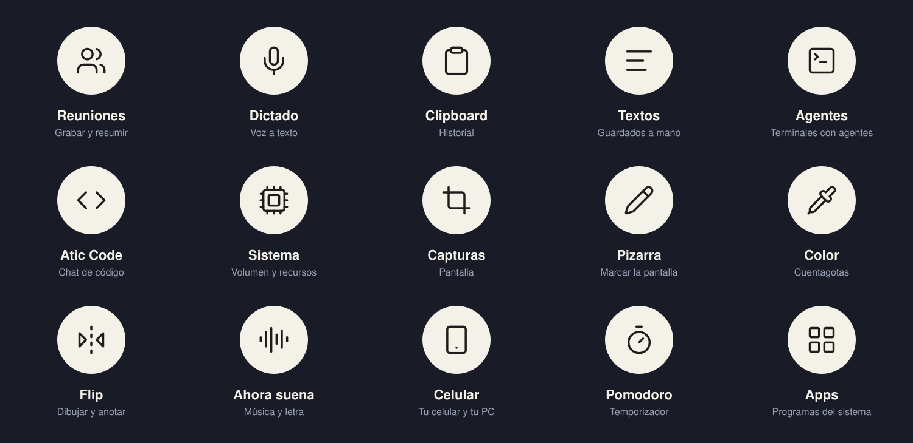
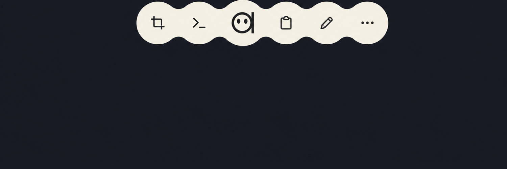
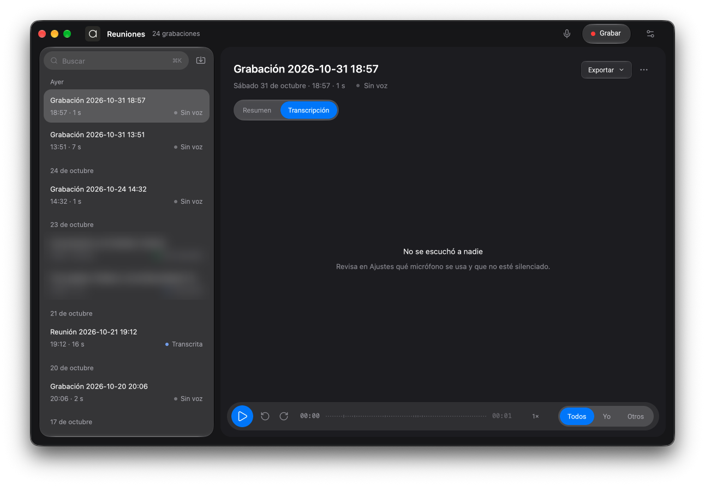
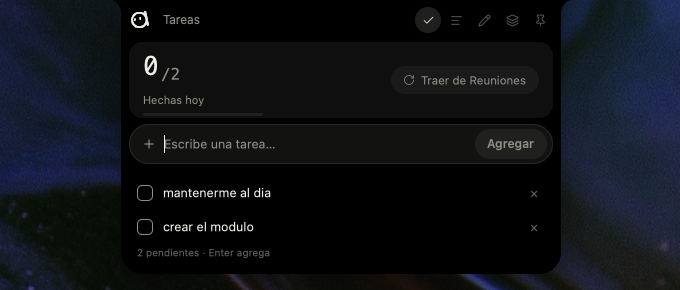
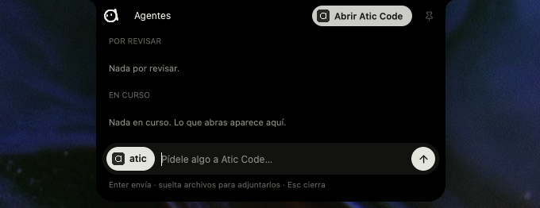
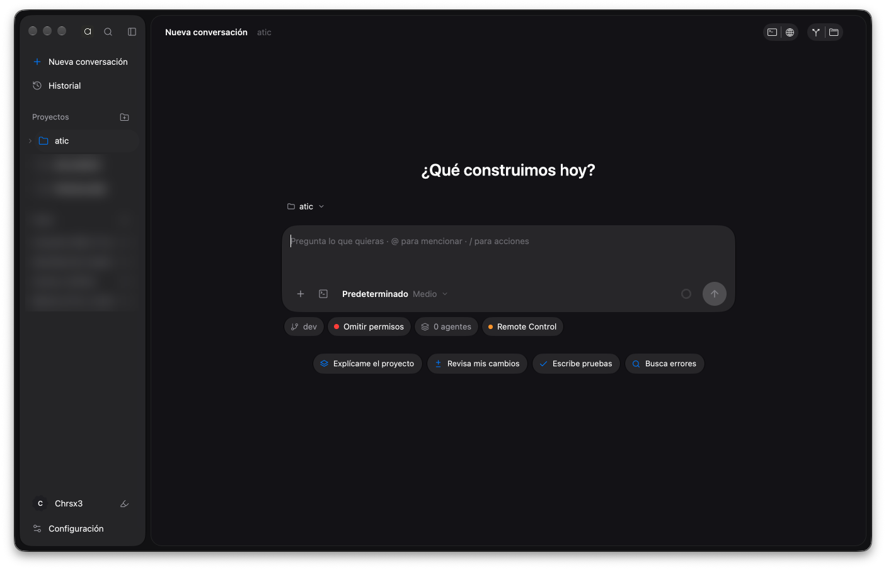
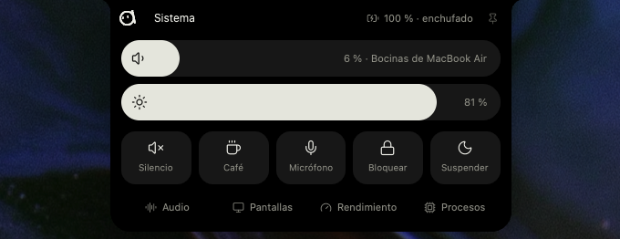
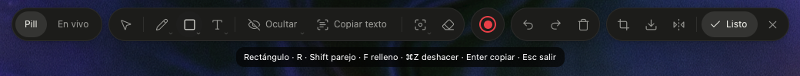
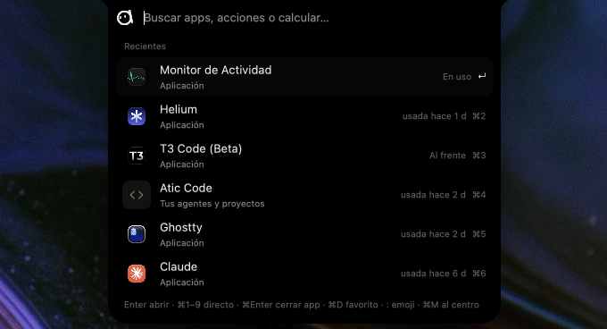
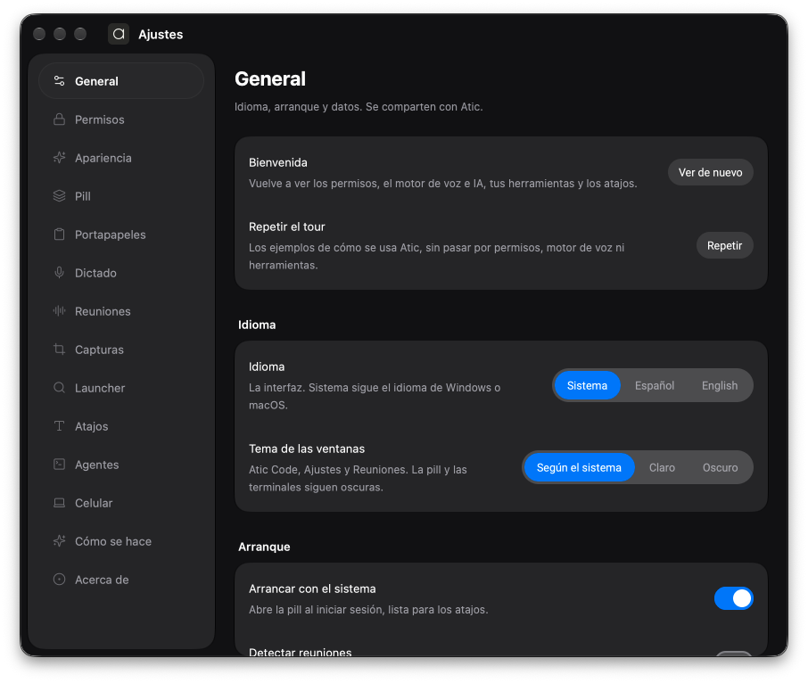

English: [TOOLS.md](TOOLS.md)

# Herramientas de Atic

Atic es una caja de herramientas de escritorio que vive en una **pill** flotante: la pill se pega al borde de
la pantalla (o flota como una burbuja) y abre herramientas que se usan ahí mismo, sin cambiar de app. Esta
guía recorre cada una: qué es, qué puedes hacer, cómo se abre y en qué cambian Windows y macOS.

Lo que se cuenta aquí sale del código y de las [Novedades](../apps/atic/assets/changelog.json) de la versión
0.5.6. Si una versión se nombra, es la primera en que el changelog menciona esa función.

## Resumen

Los atajos son los de fábrica en una instalación nueva. En Windows son `Alt` + letra; en macOS, `⌘⇧` + letra
(salvo Textos). Todos se cambian en **Ajustes → Atajos**. Quien ya cambió un atajo lo conserva.

| Herramienta | Para qué | Atajo (Windows · macOS) |
| --- | --- | --- |
| [Reuniones](#reuniones) | Grabar, transcribir y resumir llamadas y reuniones | `Alt+R` · `⌘⇧R` |
| [Dictado](#dictado) | Hablar y pegar el texto donde estabas | `Alt+D` · `⌘⇧D` |
| [Clipboard](#clipboard) | Historial de lo que copias (texto, imágenes, colores) | `Alt+V` · `⌘⇧V` |
| [Textos](#textos) | Tareas, textos guardados, bloc y notas del tablero | `Alt+Shift+V` · `⌘⌃V` |
| [Agentes](#agentes) | Ver y lanzar tus agentes CLI desde la pill | `Alt+A` · `⌘⇧A` |
| [Atic Code](#atic-code) | Ventana de trabajo con agentes: chat, archivos, cambios | desde Agentes, la bandeja o el launcher |
| [Sistema](#sistema) | Volumen, brillo, pantallas, rendimiento y procesos | sin atajo |
| [Capturas](#capturas) | Capturar o grabar la pantalla | `Alt+S` · `⌘⇧S` |
| [Copiar texto](#copiar-texto-ocr) | Elegir y copiar el texto de lo que ves | desde la mira (`G`) |
| [Editor de grabaciones](#editor-de-grabaciones) | Editar y exportar tus grabaciones (solo Mac) | botón «Editar» del estante |
| [Pizarra](#pizarra) | Dibujar sobre la pantalla congelada | `Alt+X` · `⌘⇧X` |
| [Color](#color) | Cuentagotas para tomar colores de la pantalla | `Alt+C` · `⌘⇧C` |
| [Flip](#flip) | Dar vuelta la ventana y anotar en un tablero | `Alt+B` · `⌘⇧B` |
| [Ahora suena](#ahora-suena) | Música en curso con controles y letra | sin atajo |
| [Celular](#celular) | Conectar el PC con la app de Atic para Android | sin atajo |
| [Pomodoro](#pomodoro) | Rondas de enfoque con pausas | sin atajo |
| [Apps](#apps-launcher-calculadora-y-emoji) | Launcher: apps, acciones, calculadora y emoji | `Alt+Shift+Space` · `⌘⇧Space` |
| [Bandeja de avisos](#bandeja-de-avisos) | Lo que esperan tus agentes, el celular y las actualizaciones | sin atajo |

Traer la pill al cursor y abrir la rueda con el teclado existen como atajos, pero vienen **sin combinación
asignada**; la eliges en Ajustes → Atajos.

## La pill

### La rueda y la tira

- La pill tiene tres formas: **acoplada** a cualquier borde de la pantalla (una pestaña), **tira** de
  herramientas al pasar el mouse por la pestaña, y **burbuja flotante**. Arrástrala por el borde para
  cambiarla de lugar, o al centro y suéltala para dejarla flotando; para volver, llévala a un borde.
- Flotando, al pasarle el mouse (o con clic) se abre la **rueda**: un gajo por herramienta. Si asignas un
  atajo a la rueda, lo mantienes apretado y sueltas sobre el gajo que quieras.
- El catálogo tiene 12 herramientas: Reuniones, Clipboard, Textos, Agentes, Sistema, Capturas, Pizarra, Color,
  Flip, Ahora suena, Celular y Pomodoro. Dictado, Apps, Copiar texto y la calculadora no van en la rueda: se
  usan con su atajo.
- Quedarte sobre una herramienta de la tira abre un **vistazo**: lo último de esa herramienta, usable ahí
  mismo (los últimos colores, las tres últimas capturas, los textos recientes, las páginas del Flip, CPU y
  memoria…).
- **Personalizar:** mantén apretada una herramienta medio segundo, o entra a Ajustes → Pill. Cada una puede
  quedar **a la vista**, **detrás de «Más»** (un segundo nivel) o **fuera de Atic**. Siempre debe quedar al
  menos una a la vista. Las herramientas nuevas que llegan con una versión se ofrecen una sola vez en la
  rueda.
- Desde 0.4.0 (pill acoplada a los bordes) y 0.4.39 (vistazos, personalizar, elegir su lugar y re-acople).

### El notch

- Cada herramienta con panel se abre en el **notch**: la pestaña se estira como un solo objeto y muestra el
  contenido. `Esc` lo cierra. Se pueden abrir dos paneles lado a lado (0.5.1).
- La pestaña en reposo muestra lo que pasa: el punto rojo y el reloj al grabar, la onda al dictar o al sonar
  música (con la carátula), el tiempo del Pomodoro, contadores de agentes, el punto naranja o verde cuando
  algo usa el micrófono o la cámara, y el aviso de actualización.
- Un clic en la carita de la pill abre Ajustes; quedarte sobre ella muestra **ajustes rápidos** (0.4.47):
  alternar el dictado, incluir el cursor en las capturas, guardar lo que copias y avisar al empezar una
  llamada.
- **macOS:** la pill se pega arriba junto al notch físico de la cámara en los MacBook; en monitores sin notch
  es una pestaña normal. Hay un Space por pantalla y puede cruzar al monitor vecino.

## Herramientas

### Reuniones

Graba el audio de una reunión, lo transcribe y arma un resumen editable.

- Graba el **micrófono**, el **audio del computador** o ambos, en pistas separadas («Yo» y «Los demás»).
  Eliges el micrófono y se prueba cuál suena; si el elegido no está o no entrega audio, usa otro.
- Transcribe al terminar (se puede apagar) con **Groq** (nube, con tu llave), el **modelo local Parakeet v3**
  (sin internet ni llave; se baja una vez, 671 MB; no resume) o, en Mac, la **voz de macOS**. Los subtítulos
  en vivo mientras grabas son opcionales y, con el modelo local, el audio no sale del equipo (0.5.6).
- El resumen se genera con tu propia llave (BYOK): Claude, OpenAI, OpenRouter, Groq, MiniMax, Ollama (local) o
  un servicio compatible con OpenAI. Hay plantillas: Puntos clave, Acta ejecutiva, Tareas y Correo de
  seguimiento. Puedes editarlo a mano y volver a generarlo.
- Renombra hablantes, busca dentro de la reunión, escucha desde un punto (velocidad y ±15 s) e **importa
  audio** (wav, mp3, m4a, ogg, flac) arrastrándolo.
- Exporta a Markdown, Word o PDF, copia la reunión «para Claude» y envía el resumen por correo (abre tu
  correo, o SMTP si lo configuras).
- Las tareas de los resúmenes pasan solas a [Textos](#textos).
- **Detectar reuniones** (apagado por defecto) mira el título de las ventanas de Zoom, Teams, Meet y Webex,
  solo en local, y **sugiere** grabar. Atic nunca empieza a grabar solo.
- **Se abre:** el atajo graba y detiene desde cualquier app; la herramienta del notch muestra Grabar y las
  últimas reuniones (clic en una muestra su resumen); «Abrir Reuniones» o el menú de la bandeja abren la
  ventana.
- **Windows y Mac:** en Windows se graba micrófono y audio del sistema. En Mac el audio del sistema usa
  ScreenCaptureKit (macOS 13 o superior); antes de eso, solo micrófono. Parakeet no está en Mac Intel.

### Dictado

Hablas y el texto se pega donde estabas escribiendo.

- Dos modos: **mantener** el atajo mientras hablas (el de fábrica) o **alternar** (uno empieza y otro
  termina). Un clic en la franja del notch también termina.
- Mientras escuchas, el notch muestra un punto rojo, el tiempo y la onda; después «Transcribiendo…» y, al
  pegar, el texto pegado.
- Motores: Groq, el modelo local (Parakeet v3) o la voz de macOS. El idioma es el mismo de Reuniones y eliges
  el micrófono del dictado.
- Si empezaste desde una consola de Atic Code, el texto vuelve a esa consola.
- **Solo Mac:** «Pulir con Apple Intelligence» corrige puntuación y quita muletillas antes de pegar (suma
  cerca de un segundo y requiere un Mac con Apple Intelligence). Pegar pide el permiso de Accesibilidad.
- **Se abre:** con su atajo (`Alt+D` · `⌘⇧D`). El motor local Parakeet llegó en 0.5.0.

### Clipboard

Historial local de lo que copias. Desde 0.2.0.

- Guarda texto, imágenes y colores, agrupados por día. El buscador es la franja del notch; las imágenes
  también se encuentran por el texto que contienen (lo lee el OCR del sistema).
- `Enter` pega donde estabas; `Ctrl+1`–`9` (`⌘1`–`9` en Mac) pega directo; `Ctrl+D` marca favorito;
  `Mayús+Supr` (`⌘⌫` en Mac) lo quita. También puedes **arrastrar** un elemento a otra app.
- En una imagen: `Ctrl+O` la abre, `Ctrl+T` lee su texto y `Ctrl+E` la dibuja en la Pizarra. Filtros «Solo
  texto» y «Solo imágenes».
- Lo que parece una clave se ve oculto en pantalla (`sk-ab••••xyz`) pero se pega completo. Atic **no guarda**
  lo que un gestor de contraseñas marca como sensible. «Guardar lo que copias» se apaga en Ajustes.
- Con un celular vinculado puedes mandarle un elemento o abrir un enlace allá.
- Se puede fijar el panel para que quede abierto.
- **Se abre:** `Alt+V` · `⌘⇧V`, o la herramienta de la rueda. El mismo atajo lo cierra.

### Textos

Lo que guardas tú a propósito, distinto del historial.

- **Tareas:** se escriben en la franja o llegan solas desde los resúmenes de Reuniones, con el nombre de la
  reunión (0.5.1).
- **Textos:** fragmentos listos para pegar. Admiten variables: `{fecha}`, `{hora}`, `{fecha_hora}` y
  `{portapapeles}`. `Ctrl+N` (`⌘N`) guarda lo que tienes copiado; `Enter` pega; `Ctrl+1`–`9` pega directo.
- **Bloc:** una nota que se guarda sola. **Notas del tablero:** las notas de texto y listas del [Flip](#flip),
  en solo lectura, para pegarlas.
- **Se abre:** `Alt+Shift+V` · `⌘⌃V`, o la rueda. El vistazo muestra los tres textos más recientes y un clic
  los pega.

### Agentes

El panel de tus agentes CLI en la pill. Atic **no autentica**: se cuelga del CLI que ya instalaste y con el
que ya iniciaste sesión.

- **En curso** y **por revisar**: lee las sesiones vivas de Claude Code, Codex, OpenCode y Cursor (solo las
  tocadas en los últimos 15 minutos; lo listo desaparece a los 30). Un clic trae a primer plano su terminal si
  se sabe cuál es; la flecha ↗ la reanuda en una terminal nueva o en Atic Code.
- **Mensaje rápido** para contestarle a uno o a varios agentes sin ir a su consola, y adjuntar archivos
  soltándolos.
- **Nuevo:** lanza Claude Code, OpenCode, Codex, Cursor, Antigravity o Grok en la carpeta que elijas, con su
  logo.
- **Chat con Atic Code** dentro del panel (0.5.1): eliges un proyecto, escribes y aceptas o rechazas permisos
  sin salir del notch; «Seguir en Atic Code» abre la conversación completa.
- La pill muestra los cupos de uso de cada agente (0.4.24) y hay un panel de uso con su detalle (0.4.29).
- **Orquestación por MCP** (0.4.29): `atic-mcp` deja que un agente abra, le hable y delegue en otros agentes
  (`atic_spawn`, `atic_prompt`, `atic_delegate`, `atic_wait`…). Se conecta desde Ajustes → Agentes (MCP).
- **Se abre:** `Alt+A` · `⌘⇧A`, o la rueda.

### Atic Code

Tu espacio de trabajo con agentes en una ventana (desde 0.4.46).

- **Espacios de trabajo:** un nombre con una o varias carpetas, cada uno con sus conversaciones (las abiertas
  y las que guardó Claude Code). También chat suelto, sin proyecto. Se puede importar un workspace de VS Code.
- **Chat** con Claude Code, Codex, OpenCode, Cursor y Grok (OpenCode, Cursor y Grok por ACP, Codex por su
  propio protocolo; agentes ACP desde 0.4.48). Modos de permisos (preguntar, editar automáticamente, plan,
  omitir permisos), esfuerzo y modelo, adjuntar imágenes, volver a un mensaje anterior (código, conversación o
  ambos) y responder permisos o preguntas del agente.
- **Archivos y cambios:** árbol de archivos y cambios de git a la derecha, con visor.
- **Consolas** embebidas con tantas pestañas y divisiones como quieras (0.4.21), y una ventana de consolas con
  sesiones que se retoman.
- **Vista previa web** (0.5.3; en Windows desde 0.5.4): se abre sola cuando un agente levanta un servidor
  local o crea un HTML.
- **Dispositivos:** emulador de Android y, solo en Mac, simulador de iOS, vistos dentro de la ventana.
- **Preparar Atic Code** guía la instalación de Node y de Claude Code, y el inicio de sesión (0.5.2). Un panel
  de uso muestra los cupos de cada agente.
- Cierra por tiempo las conversaciones inactivas (0.4.49).
- **Se abre:** desde el panel de Agentes, «Atic Code» en el menú de la bandeja o el launcher («Nueva sesión de
  Claude Code», «Chat suelto»).

### Sistema

Un centro de control del equipo.

- Arriba: **volumen** y **brillo**, silencio, **café** (mantener el equipo despierto), **bloquear** y
  **suspender**. Lo que no se deshace (bloquear, suspender, forzar el cierre) pide un segundo clic para
  confirmar.
- **Audio:** la salida (parlantes, audífonos), quién usa el micrófono o la cámara y el volumen de cada app con
  sonido.
- **Pantallas** (0.5.5): brillo, resolución y frecuencia de cada pantalla, cuál es la principal, duplicar o
  extender, modo oscuro y conectar una pantalla inalámbrica. Un cambio de resolución vuelve solo a la anterior
  si no lo confirmas en 15 s.
- **Rendimiento** (0.5.5): CPU, GPU, memoria y red del último minuto en vivo, temperaturas, discos y batería.
- **Procesos:** lo que más consume, con buscador, para cerrarlo o forzarlo.
- **Liberar espacio** (0.5.5, **solo macOS**): encuentra compilaciones de proyectos, cachés y lo que deja
  Xcode, e instaladores olvidados en Descargas; lo manda a la Papelera (nada de documentos). Lo usado hace
  menos de 7 días va desmarcado.
- **Se abre:** la rueda o el launcher («Volumen y brillo»); sin atajo propio.

### Capturas

Captura o graba la pantalla.

- La **mira** congela la pantalla. Arrastras una zona, haces clic en una ventana o pulsas `Espacio` para toda
  la pantalla. `F` alterna entre pantalla congelada y en vivo; `P` oculta la pill; `Esc` cancela.
- La barra de la mira cambia entre **Captura** y **Grabar** (`R`), con micrófono (`M`), sonido del computador
  (`A`) y pill (`P`) a un clic (0.5.6). `D` abre la [Pizarra](#pizarra) al soltar, para marcar antes de
  copiar, y `G` elige texto de la pantalla ([Copiar texto](#copiar-texto-ocr)).
- La imagen va al portapapeles y a un **estante** flotante con sus opciones: descartar, abrir la carpeta,
  copiar, dibujar y texto. Clic en la foto la abre; arrastrarla la suelta en otra app. El estante se retira a
  los 20 s y las capturas se guardan 24 h por defecto (se cambia en Ajustes → Capturas, igual que incluir el
  puntero).
- Las **grabaciones** quedan en `Videos\Atic` (Windows) o `~/Movies/Atic` (Mac), con micrófono y sonido del
  sistema, y llegan al estante. Un clic en el tab o el mismo atajo la detienen; el vistazo permite pausar o
  descartar.
- **Solo Mac:** «Cursor suave» graba sin el cursor del sistema y dibuja uno suavizado; la grabación va en HEVC
  en Apple Silicon (pesa cerca de la mitad) y pausar no corta el video (0.5.6).
- **Se abre:** `Alt+S` · `⌘⇧S`, «Capturar pantalla» en el menú de la bandeja o el launcher, o la rueda.
  Capturas en macOS desde 0.4.35. Funciona con varias pantallas, también con escalas distintas.

### Copiar texto (OCR)

Elige y copia el texto de cualquier cosa que veas, incluso de imágenes, con el OCR del sistema (Windows o
Vision en Mac).

- La pantalla se oscurece un poco y cada palabra reconocida se ilumina. Arrastra para elegir; doble clic elige
  una palabra, triple una línea y `Ctrl+A` todo; `Ctrl+C` copia.
- Respeta columnas y párrafos, y copia las **tablas como tabla** (0.5.5). En una interfaz con barra lateral y
  paneles, la selección no se pasa a la columna de al lado (0.5.6).
- **Se abre:** con `G` en la mira de Capturas, con «Texto» en una captura del estante, con `G` en la Pizarra,
  con `Ctrl+T` en una imagen del Clipboard o con «Copiar texto de la pantalla» en el launcher.

### Editor de grabaciones

**Solo macOS** (0.5.6). Un editor de video para tus grabaciones de pantalla, con el estilo de ventana que
elijas en Apariencia.

- **Autofocus:** zoom automático en tus clics y donde escribes; la cámara sigue al mouse sin pegarse al borde.
- **Fondo:** degradados, 18 imágenes de fondo o la tuya, margen, esquinas y sombra. **Cursor:** tamaño,
  suavizado, forma y onda al hacer clic.
- **Montaje:** recorte y cortes, velocidades, textos con estilo, zonas difuminadas o pixeladas, deshacer y
  rehacer, y línea de tiempo con zoom.
- **Subtítulos automáticos**, generados en tu equipo sin internet.
- **Exportar:** horizontal, vertical (9:16), cuadrado (1:1) o 4:5, como video (H.264 o HEVC) o GIF. Siempre
  sale otro archivo «(editada)»: no pisa tu grabación.
- **Asistente:** le pides los cambios a Claude, Codex, OpenCode o Cursor (y eliges el modelo); el agente ve la
  grabación y la edita con las herramientas del editor.
- **Se abre:** con **Editar** en el estante, junto a una grabación. En Windows aún no existe.

### Pizarra

Congela la pantalla y márcala ahí mismo (desde 0.4.5).

- Herramientas agrupadas en islas: lápiz y resaltador; líneas, flechas (también curvas), rectángulos y
  elipses; texto, globos y pasos 1, 2, 3; foco, lupa, medir, cuentagotas, emoji y sellos; borrador y mover.
- **Ocultar datos:** pixelar a mano o «Detectar datos», que busca correos, teléfonos, RUT y claves y los
  pixela.
- **Copiar texto** de la imagen (`G`) y **recortar** lo que sale al exportar.
- Dibuja sobre la foto congelada o **en vivo** sobre la pantalla real (la foto se toma al terminar). `Shift`
  da líneas rectas, cuadrados y círculos; `Ctrl+Z` deshace.
- Al terminar copia y guarda. Exportas con tamaño (50, 100 o 200 %), PNG o JPG, solo lo dibujado o con la
  foto, marco de color y marca de agua. También puedes enviar lo dibujado a [Flip](#flip) o a un agente
  (0.4.47).
- **Se abre:** `Alt+X` · `⌘⇧X`, la rueda o el launcher. Desde Capturas con `D`. `Esc` la cierra.

### Color

Un cuentagotas para tomar colores de la pantalla (0.4.28).

- Una lupa de 13×13 píxeles sigue al cursor. Clic o `Enter` copia el color y cierra. Las flechas mueven el
  cursor 1 px (`Shift`: 10) para clavar el píxel.
- `Tab` cambia el formato: HEX, RGB o HSL. `R` abre la rosa cromática: un cuadro de saturación y brillo,
  matiz, HEX y colores recientes.
- Los colores copiados se ven en el historial del [Clipboard](#clipboard) y en el vistazo de la herramienta.
- **Se abre:** `Alt+C` · `⌘⇧C`, la rueda o el launcher. Funciona en todas las pantallas.

### Flip

La ventana del frente se da vuelta y detrás aparece un tablero para anotar.

- El tablero es un papel continuo de hasta 10 páginas con textos, listas con casillas, imágenes y dibujo a
  mano alzada. Se guarda solo y lo ves desde cualquier ventana.
- Inserta desde el portapapeles, Textos o Capturas; pega con `Ctrl+V` o arrastra imágenes. **Importa
  reuniones** con su resumen y las tareas como casillas (0.4.47).
- Herramientas: lápiz, resaltador, borrador, texto, lista, mover y mano. Zoom y desplazamiento, selección por
  recuadro, deshacer y rehacer.
- **Exporta** a PNG, JPEG, PDF, Word o PowerPoint, una página por hoja; las imágenes salen en un `.zip` si son
  varias.
- **Se abre:** `Alt+B` · `⌘⇧B`, o la rueda. El mismo atajo, `Esc` o «Volver» lo cierra. Si el equipo está muy
  ocupado, el Flip se cancela y tu ventana sigue donde estaba.

### Ahora suena

Lo que reproduce cualquier app que se lo cuenta al sistema (Spotify, el navegador con YouTube…).

- Carátula, título y artista; play y pausa, anterior y siguiente, ±10 s y una barra de progreso que se
  arrastra.
- Volumen del equipo y volumen de cada app, y elegir la salida de audio.
- **Letra sincronizada** del tema (desde LRCLIB; solo viajan título, artista y duración). Cuelga del notch y
  se apaga en Ajustes → Pill.
- La pestaña muestra la carátula y una onda con el nivel real del audio. En pausa, la carátula queda atenuada
  con un ▶ 10 minutos para reanudar.
- El vistazo se transforma en el panel (0.4.50) y el panel se despliega desde la carátula con el scroll
  (0.4.49).
- **Se abre:** la rueda o la carátula de la pestaña; sin atajo. También en el launcher («Música»).
- **Windows:** lee la sesión de medios del sistema. **Mac:** lee MediaRemote mediante `osascript`.

### Celular

Conecta el PC con la app de **Atic para Android**. Va cifrado de punta a punta, sin cuentas ni nube de Atic.
Se vincula en **Ajustes → Celular** con un código QR (0.4.46); en la misma red, el celular y el PC se
encuentran solos (0.5.0).

- Portapapeles compartido en los dos sentidos; lo que un gestor de contraseñas marca como sensible no sale.
- Avisos del celular en la pill, con respuesta, y **llamadas**: quién llama, contestar o colgar.
- Archivos, enlaces y fotos entre los dos; pedir una **foto con la cámara del celular** que llega al
  portapapeles del PC; hacer **sonar el celular** para encontrarlo.
- Música del PC, y ver y contestar agentes desde el teléfono, incluidos sus permisos. Detener una grabación de
  Reuniones desde ahí.
- **Pantalla del celular en el PC** (0.5.3), en una ventana, solo para mirar o con control; y **la del PC en
  el celular** con toque absoluto (0.5.3, 0.5.5).
- Chat y zumbidos entre dos Atic vinculados (0.5.4).
- Dos permisos se activan a propósito en Ajustes → Celular: **Escribirle a los agentes** y **Controlar el PC**
  (volumen, bloquear, diapositivas, panel táctil y teclado, ver la pantalla del PC).
- **Se abre:** la rueda («Celular») muestra los avisos; la bandeja del notch avisa llamadas y pedidos de
  acceso.

### Pomodoro

Rondas de enfoque con pausas (0.5.1).

- De fábrica: 25 min de enfoque, 5 de pausa corta y 15 de pausa larga cada cuatro enfoques. Todo se ajusta en
  su panel.
- El panel muestra el anillo con el tiempo, los modos (Enfoque, Pausa corta, Pausa larga), empezar, pausar y
  seguir, y lo enfocado hoy.
- Opciones: que la siguiente ronda arranque sola y sonar al terminar. Al terminar llega un aviso del sistema.
- Corriendo, el tiempo se ve en la pestaña en reposo. El reloj sale del reloj del sistema: si la pill se
  atrasa, el Pomodoro no.
- **Se abre:** la rueda; sin atajo.

### Apps, launcher, calculadora y emoji

Un buscador tipo Spotlight: la franja del notch es el campo.

- Abre **apps** (menú Inicio y Store en Windows; apps del sistema, íconos y Recientes en Mac) y **acciones**:
  capturar, Pizarra, Color, Clipboard, Textos, Flip, copiar texto de la pantalla, grabar una reunión, Música,
  Volumen y brillo, Ajustes, Atic Code, modo oscuro, silenciar, bloquear, suspender y vaciar la papelera.
- **Favoritos** (máximo 8) como pelotitas al final de la barra, con `Ctrl+D`; `Ctrl+1`–`9` abre directo y
  `Ctrl+M` lo pasa al centro de la pantalla. `Ctrl+Enter` cierra la app elegida (0.4.34) o abre una carpeta
  reciente en tu editor.
- **Calculadora** (0.4.34): aritmética, unidades (longitud, masa, volumen, área, velocidad, tiempo, datos) y
  zonas horarias («15:00 chile en madrid»). `Enter` copia el resultado.
- **Divisas** (0.4.41, opt-in en Ajustes → Launcher): «30.000 CLP a UF», «30 USD a CLP». Consulta
  mindicador.cl y exchangerate-api.com, muestra la fecha de la tasa y no envía lo que escribes.
- **Emoji:** `:` con la barra vacía abre el catálogo, con búsqueda en español e inglés y tonos de piel;
  `Enter` pega, `Ctrl+Enter` copia.
- **Se abre:** `Alt+Shift+Space` · `⌘⇧Space`.

### Bandeja de avisos

Lo que espera tu atención, dentro del notch y sin ventanas aparte.

- **Agentes:** un turno terminado (*por revisar*) o un permiso (*decisión*). Contadores a los lados de la
  marca de la pill: cuántos agentes trabajan y cuántos esperan. Un permiso se contesta ahí mismo.
- **Celular:** avisos, llamadas (contestar o colgar) y pedidos del celular para controlar el PC o escribirle a
  tus agentes.
- **Actualizaciones:** «Atic X disponible», que se instala sola y reabre la pill. **Novedades** muestra qué
  cambió, la primera vez tras actualizar y desde el menú de la bandeja.
- **Menú del ícono** (bandeja en Windows, barra de menús en Mac): Ajustes, Capturar pantalla, Reuniones, Atic
  Code, Novedades y Salir.

## Ajustes

Se abre con un clic en la carita de la pill, desde la bandeja o el launcher.

- Secciones: General, Apariencia, Pill, Clipboard, Dictado, Reuniones, Capturas, Launcher, Atajos, Agentes,
  Celular, Permisos (macOS), Cómo se hace y Acerca de.
- **Apariencia:** tema claro, oscuro o del sistema; estilo de las ventanas (Atic, Material 3 Expressive o
  Liquid Glass en macOS 26); color de la pill y su transparencia.
- **Idioma:** español o inglés (0.5.0), o el del sistema.
- **Cómo se hace** repite el tour guiado; la **Bienvenida** pide permisos, motor de voz y elige tus
  herramientas.
- **Acerca de:** busca actualizaciones (al abrir y cada 6 horas); instalar descarga, comprueba la firma y
  reinicia.
- **Permisos (macOS):** Accesibilidad, Monitoreo de entrada, Grabación de pantalla, Micrófono y Audio del
  sistema, con su estado y un botón para pedirlos. Detalles en [`MACOS.md`](MACOS.md).

## Privacidad

Las grabaciones, transcripciones, el historial y las conversaciones de agentes viven en tu disco. Las llaves
(Groq, Claude, OpenAI…) y la contraseña SMTP van al llavero del sistema. El modelo local (Parakeet) y la voz
de macOS transcriben en tu equipo; Groq y los proveedores de resumen reciben solo lo que eliges usar (el
audio, si transcribes con Groq; el texto, al resumir). No hay cuenta de Atic ni telemetría de producto.
