Español: [HERRAMIENTAS.md](HERRAMIENTAS.md)

# Atic tools

Atic is a desktop toolbox that lives in a floating **pill**. The pill sticks to a screen edge (or floats like
a bubble) and opens tools you use right there, without switching apps. This guide walks through each one: what
it is, what you can do with it, how to open it, and where Windows and macOS differ.

Everything here comes from the code and from the [release notes](../apps/atic/assets/changelog.json) up to
version 0.5.6. When a version is named, it is the first one whose changelog mentions that feature.

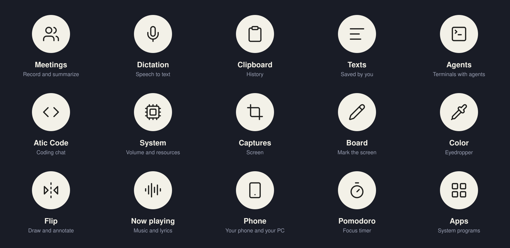

## Overview

Shortcuts are the defaults on a fresh install. On Windows they are `Alt` + letter; on macOS, `⌘⇧` + letter
(except Texts). You can change all of them in **Settings → Shortcuts**, and a shortcut you already changed is
kept.

| Tool | What it is for | Shortcut (Windows · macOS) |
| --- | --- | --- |
| [Meetings](#meetings) | Record, transcribe and summarize calls and meetings | `Alt+R` · `⌘⇧R` |
| [Dictation](#dictation) | Speak and paste the text where you were typing | `Alt+D` · `⌘⇧D` |
| [Clipboard](#clipboard) | History of what you copy (text, images, colors) | `Alt+V` · `⌘⇧V` |
| [Texts](#texts) | Tasks, saved snippets, a notepad and board notes | `Alt+Shift+V` · `⌘⌃V` |
| [Agents](#agents) | See and launch your CLI agents from the pill | `Alt+A` · `⌘⇧A` |
| [Atic Code](#atic-code) | Workspace window for agents: chat, files, changes | from Agents, the tray or the launcher |
| [System](#system) | Volume, brightness, displays, performance and processes | no shortcut |
| [Captures](#captures) | Take a screenshot or record the screen | `Alt+S` · `⌘⇧S` |
| [Copy text](#copy-text-ocr) | Select and copy the text you see on screen | from the crosshair (`G`) |
| [Recording editor](#recording-editor) | Edit and export your recordings (Mac only) | «Edit» button on the shelf |
| [Board](#board) | Draw on the frozen screen | `Alt+X` · `⌘⇧X` |
| [Color](#color) | Eyedropper to pick colors from the screen | `Alt+C` · `⌘⇧C` |
| [Flip](#flip) | Flip the window over and take notes on a board | `Alt+B` · `⌘⇧B` |
| [Now playing](#now-playing) | Current music with controls and lyrics | no shortcut |
| [Phone](#phone) | Connect your PC with the Atic app for Android | no shortcut |
| [Pomodoro](#pomodoro) | Focus rounds with breaks | no shortcut |
| [Apps](#apps-launcher-calculator-and-emoji) | Launcher: apps, actions, calculator and emoji | `Alt+Shift+Space` · `⌘⇧Space` |
| [Notices tray](#notices-tray) | What your agents, phone and updates are waiting on | no shortcut |

Bringing the pill to the cursor and opening the wheel from the keyboard exist as shortcuts, but they ship
**with no key combination assigned**; you pick one in Settings → Shortcuts.

## The pill

### The wheel and the strip

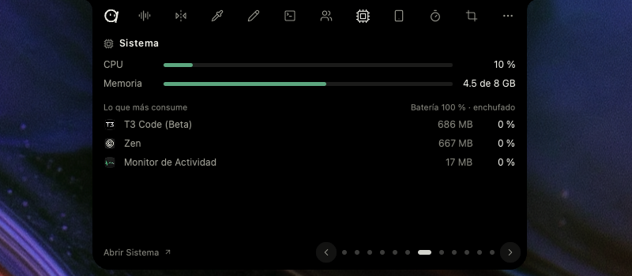

- The pill has three shapes: **docked** to any screen edge (a small tab), a **strip** of tools when you hover
  the tab, and a **floating bubble**. Drag it along an edge to move it, or to the middle of the screen and
  release to leave it floating; to dock it again, take it to an edge.
- When floating, hovering it (or clicking) opens the **wheel**: one segment per tool. If you assign a shortcut
  to the wheel, you hold it down and release over the segment you want.
- The catalog has 12 tools: Meetings, Clipboard, Texts, Agents, System, Captures, Board, Color, Flip, Now
  playing, Phone and Pomodoro. Dictation, Apps, Copy text and the calculator are not on the wheel: you use
  them with their shortcut.
- Staying on a tool in the strip opens a **peek**: the latest from that tool, usable right there (recent
  colors, the last three captures, recent texts, Flip pages, CPU and memory…).
- **Customize:** hold a tool for half a second, or go to Settings → Pill. Each tool can be **in view**,
  **behind «More»** (a second level) or **out of Atic**. At least one tool must stay in view. Tools added in a
  new version are offered on the wheel only once.
- Since 0.4.0 (pill docked to the edges) and 0.4.39 (peeks, customizing, choosing its home and re-docking).

### The notch

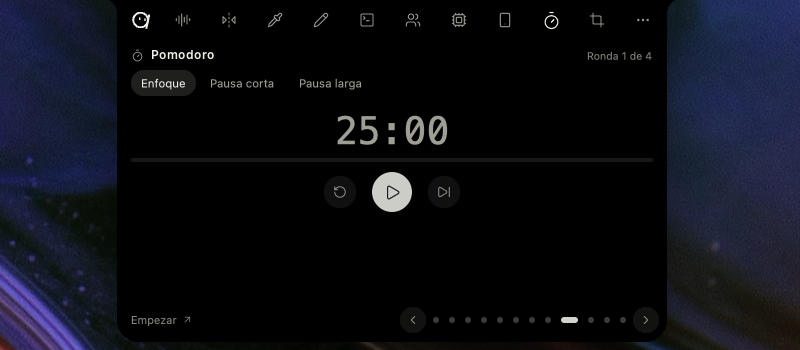

- Every tool with a panel opens in the **notch**: the tab stretches as a single object and shows the content.
  `Esc` closes it. Two panels can sit side by side (0.5.1).
- The resting tab shows what is going on: the red dot and clock while recording, the wave while dictating or
  playing music (with the cover art), the Pomodoro time, agent counters, an orange or green dot when something
  is using the microphone or camera, and the update notice.
- Clicking the pill's little face opens Settings; hovering it shows **quick settings** (0.4.47): toggle
  dictation mode, include the cursor in captures, save what you copy, and warn when a call starts.
- **macOS:** the pill docks at the top next to the physical camera notch on MacBooks; on displays without a
  notch it is a regular tab. There is one Space per display, and the pill can cross to the neighboring
  monitor.

## Tools

### Meetings

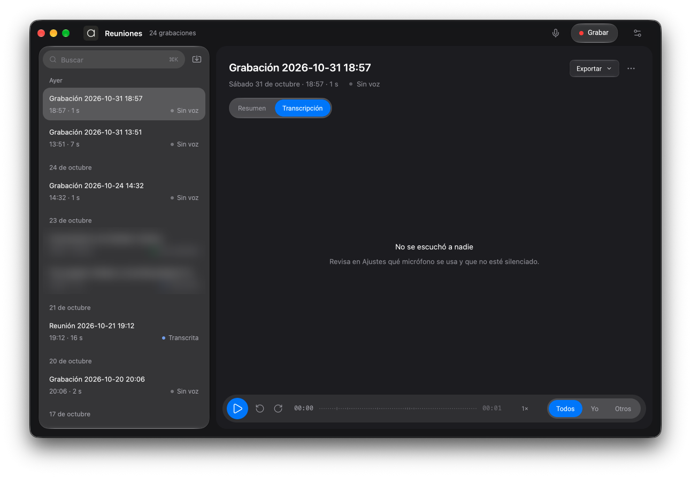

Records the audio of a meeting, transcribes it and builds an editable summary.

- Records the **microphone**, the **computer audio**, or both, on separate tracks («Me» and «Others»). You
  pick the microphone and test which one is picking up sound; if the chosen one is missing or silent, Atic
  uses another.
- Transcribes when you stop (you can turn that off) with **Groq** (cloud, using your key), the **local
  Parakeet v3 model** (no internet or key; downloaded once, 671 MB; it does not summarize) or, on Mac, the
  **macOS voice**. Live captions while recording are optional, and with the local model the audio never leaves
  your computer (0.5.6).
- The summary uses your own key (BYOK): Claude, OpenAI, OpenRouter, Groq, MiniMax, Ollama (local) or any
  OpenAI-compatible service. Templates: Key points, Executive minutes, Tasks and Follow-up email. You can edit
  it by hand and regenerate it.
- Rename speakers, search inside a meeting, listen from any point (speed and ±15 s) and **import audio** (wav,
  mp3, m4a, ogg, flac) by dropping files on the window.
- Export to Markdown, Word or PDF, copy the meeting «for Claude», and email the summary (opens your mail
  client, or SMTP if you set it up).
- Tasks in summaries move to [Texts](#texts) on their own.
- **Detect meetings** (off by default) reads the window titles of Zoom, Teams, Meet and Webex, locally, and
  only **suggests** recording. Atic never starts recording on its own.
- **Opens:** the shortcut starts and stops recording from any app; the notch tool shows Record and your latest
  meetings (click one to see its summary); «Open Meetings» or the tray menu opens the full window.
- **Windows and Mac:** on Windows it records the microphone and system audio. On Mac, system audio uses
  ScreenCaptureKit (macOS 13 or later); before that, microphone only. Parakeet is not available on Intel Macs.

### Dictation

You speak and the text is pasted where you were typing.

- Two modes: **hold** the shortcut while you speak (the default) or **toggle** (one press starts, another
  ends). Clicking the notch strip also ends it.
- While listening, the notch shows a red dot, the time and the wave; then «Transcribing…» and, once pasted,
  the pasted text.
- Engines: Groq, the local model (Parakeet v3) or the macOS voice. The language is the same as Meetings, and
  you can pick the dictation microphone.
- If you started from an Atic Code console, the text goes back to that console.
- **Mac only:** «Polish with Apple Intelligence» fixes punctuation and removes filler words before pasting (it
  adds about a second and needs a Mac with Apple Intelligence). Pasting needs the Accessibility permission.
- **Opens:** with its shortcut (`Alt+D` · `⌘⇧D`). The local Parakeet engine arrived in 0.5.0.

### Clipboard

A local history of what you copy. Since 0.2.0.

- Keeps text, images and colors, grouped by day. The search field is the notch strip; images can also be found
  by the text they contain (read by the system OCR).
- `Enter` pastes where you were; `Ctrl+1`–`9` (`⌘1`–`9` on Mac) pastes directly; `Ctrl+D` marks a favorite;
  `Shift+Del` (`⌘⌫` on Mac) removes it. You can also **drag** an item into another app.
- On an image: `Ctrl+O` opens it, `Ctrl+T` reads its text and `Ctrl+E` draws on it in the Board. Filters:
  «Text only» and «Images only».
- Anything that looks like a key is shown hidden on screen (`sk-ab••••xyz`) but pastes in full. Atic **does
  not store** what a password manager marks as sensitive. «Save what you copy» can be turned off in Settings.
- With a linked phone you can send an item to it or open a link there.
- The panel can be pinned so it stays open.
- **Opens:** `Alt+V` · `⌘⇧V`, or the wheel tool. The same shortcut closes it.

### Texts

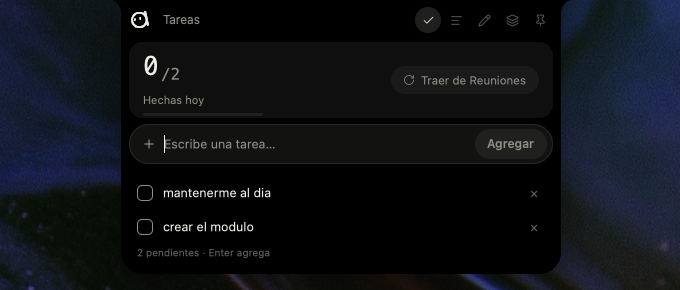

What you save on purpose, as opposed to the history.

- **Tasks:** typed into the strip or brought in from Meetings summaries, tagged with the meeting (0.5.1).
- **Texts:** snippets ready to paste. They support variables: `{fecha}` (date), `{hora}` (time),
  `{fecha_hora}` (date and time) and `{portapapeles}` (clipboard). `Ctrl+N` (`⌘N`) saves what you have copied;
  `Enter` pastes; `Ctrl+1`–`9` pastes directly.
- **Notepad:** a single note that saves itself. **Board notes:** the text notes and lists from [Flip](#flip),
  read-only, ready to paste.
- **Opens:** `Alt+Shift+V` · `⌘⌃V`, or the wheel. The peek shows your three latest texts and a click pastes
  one.

### Agents

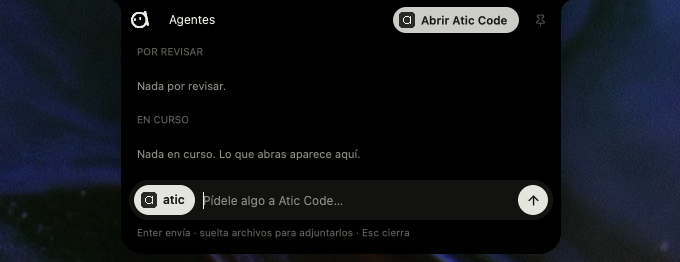

The panel for your CLI agents on the pill. Atic **does not authenticate**: it hooks into the CLI you already
installed and signed in to.

- **Running** and **to review:** reads live sessions from Claude Code, Codex, OpenCode and Cursor (only files
  touched in the last 15 minutes; finished ones disappear after 30). A click brings its terminal to the front
  when it can tell which one it is; the ↗ arrow resumes it in a new terminal or in Atic Code.
- **Quick message** to answer one or several agents without going to their console, and attach files by
  dropping them.
- **New:** launches Claude Code, OpenCode, Codex, Cursor, Antigravity or Grok in the folder you choose, with
  their logos.
- **Chat with Atic Code** inside the panel (0.5.1): pick a project, type, and accept or reject permissions
  without leaving the notch; «Continue in Atic Code» opens the full conversation.
- The pill shows each agent's usage quotas (0.4.24), and a usage panel gives the details (0.4.29).
- **MCP orchestration** (0.4.29): `atic-mcp` lets an agent open, talk to and delegate to other agents
  (`atic_spawn`, `atic_prompt`, `atic_delegate`, `atic_wait`…). You connect it from Settings → Agents (MCP).
- **Opens:** `Alt+A` · `⌘⇧A`, or the wheel.

### Atic Code

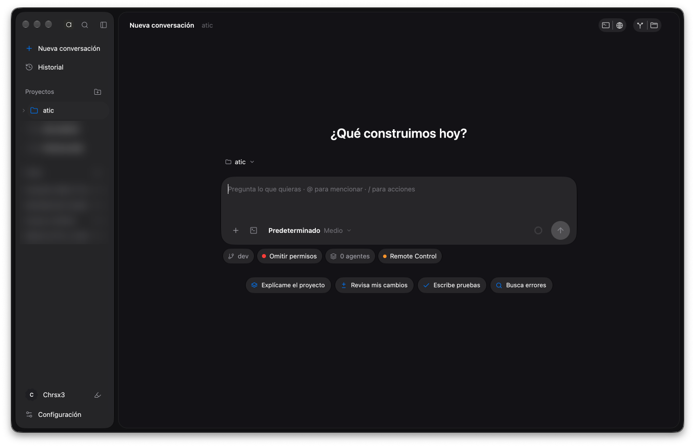

Your agent workspace in one window (since 0.4.46).

- **Workspaces:** a name with one or more folders, each with its conversations (the open ones and those saved
  by Claude Code). There is also a loose chat with no project. You can import a VS Code workspace.
- **Chat** with Claude Code, Codex, OpenCode, Cursor and Grok (OpenCode, Cursor and Grok over ACP, Codex over
  its own protocol; ACP agents since 0.4.48). Permission modes (ask, accept edits automatically, plan, bypass
  permissions), effort and model, image attachments, going back to an earlier message (code, conversation or
  both), and answering the agent's permissions or questions.
- **Files and changes:** a file tree and git changes on the right, with a viewer.
- Embedded **consoles** with as many tabs and splits as you want (0.4.21), and a consoles window with
  resumable sessions.
- **Web preview** (0.5.3; on Windows since 0.5.4): opens by itself when an agent starts a local server or
  creates an HTML file.
- **Devices:** an Android emulator and, on Mac only, an iOS simulator, shown inside the window.
- **Set up Atic Code** walks you through installing Node and Claude Code and signing in (0.5.2). A usage panel
  shows each agent's quotas.
- Idle conversations are closed after a while (0.4.49).
- **Opens:** from the Agents panel, «Atic Code» in the tray menu, or the launcher («New Claude Code session»,
  «Loose chat»).

### System

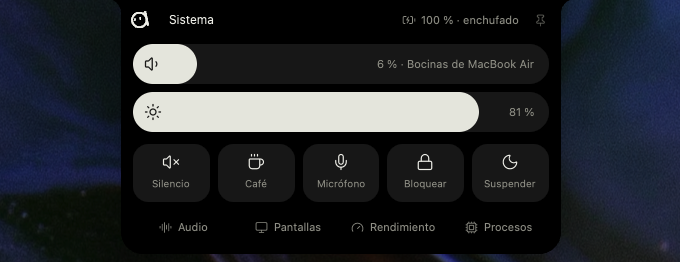

A control center for your computer.

- On top: **volume** and **brightness**, mute, **coffee** (keep the computer awake), **lock** and **sleep**.
  Anything you cannot undo (lock, sleep, force quit) asks for a second click to confirm.
- **Audio:** the output (speakers, headphones), who is using the microphone or camera, and the volume of each
  app that is playing sound.
- **Displays** (0.5.5): brightness, resolution and refresh rate for each display, which one is primary, mirror
  or extend, dark mode, and connecting a wireless display. A resolution change reverts by itself if you do not
  confirm it within 15 s.
- **Performance** (0.5.5): live CPU, GPU, memory and network for the last minute, temperatures, disks and
  battery.
- **Processes:** what uses the most, with a search field, to close or force quit it.
- **Free up space** (0.5.5, **macOS only**): finds project builds, caches and what Xcode leaves behind, plus
  forgotten installers in Downloads, and sends them to the Trash (never documents). Anything used in the last
  7 days starts unchecked.
- **Opens:** the wheel or the launcher («Volume and brightness»); no shortcut of its own.

### Captures

Take a screenshot or record the screen.

- The **crosshair** freezes the screen. Drag a region, click a window, or press `Space` for the whole screen.
  `F` toggles between frozen and live; `P` hides the pill; `Esc` cancels.
- The crosshair bar switches between **Capture** and **Record** (`R`), with microphone (`M`), computer sound
  (`A`) and pill (`P`) one click away (0.5.6). `D` opens the [Board](#board) on release so you can mark up
  before copying, and `G` selects text from the screen ([Copy text](#copy-text-ocr)).
- The image goes to the clipboard and to a floating **shelf** with its options: dismiss, open the folder,
  copy, draw and text. Clicking the photo opens it; dragging it drops it into another app. The shelf item
  leaves after 20 s, and captures are kept for 24 h by default (you can change that in Settings → Captures,
  along with including the pointer).
- **Recordings** are saved to `Videos\Atic` (Windows) or `~/Movies/Atic` (Mac), with microphone and system
  sound, and also land on the shelf. A click on the tab or the same shortcut stops it; the peek lets you pause
  or discard.
- **Mac only:** «Smooth cursor» records without the system cursor and draws a smoothed one; recordings use
  HEVC on Apple Silicon (about half the size) and pausing no longer cuts the video (0.5.6).
- **Opens:** `Alt+S` · `⌘⇧S`, «Capture screen» in the tray menu or the launcher, or the wheel. Captures on
  macOS since 0.4.35. Works with several displays, including ones with different scales.

### Copy text (OCR)

Select and copy the text from anything you can see, even images, using the system OCR (Windows OCR, or Vision
on Mac).

- The screen dims slightly and every recognized word lights up. Drag to select; double-click selects a word,
  triple-click a line and `Ctrl+A` everything; `Ctrl+C` copies.
- It respects columns and paragraphs and copies **tables as tables** (0.5.5). In an interface with a sidebar
  and panels, the selection does not spill into the neighboring column (0.5.6).
- **Opens:** with `G` in the Captures crosshair, with «Text» on a shelf capture, with `G` in the Board, with
  `Ctrl+T` on a Clipboard image, or with «Copy text from the screen» in the launcher.

### Recording editor

**macOS only** (0.5.6). A video editor for your screen recordings, in the window style you pick in Appearance.

- **Autofocus:** automatic zoom on your clicks and where you type; the camera follows the mouse without
  sticking to the edge.
- **Background:** gradients, 18 background images or your own, padding, corners and shadow. **Cursor:** size,
  smoothing, shape and a ripple on click.
- **Editing:** trim and cuts, speeds, styled text, blurred or pixelated zones, undo and redo, and a timeline
  with zoom.
- **Automatic captions**, generated on your computer without internet.
- **Export:** landscape, vertical (9:16), square (1:1) or 4:5, as video (H.264 or HEVC) or GIF. It always
  writes a separate «(edited)» file: your recording is never overwritten.
- **Assistant:** ask Claude, Codex, OpenCode or Cursor for the changes (and pick the model); the agent sees
  the recording and edits it with the editor's tools.
- **Opens:** with **Edit** on the shelf, next to a recording. It does not exist on Windows yet.

### Board

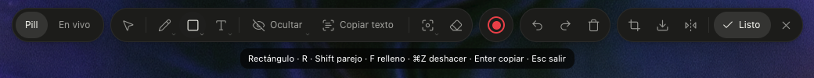

Freeze the screen and mark it up right where it is (since 0.4.5).

- Tools grouped in islands: pen and highlighter; lines, arrows (also curved), rectangles and ellipses; text,
  callouts and steps 1, 2, 3; focus, magnifier, ruler, eyedropper, emoji and stamps; eraser and move.
- **Hide data:** pixelate by hand or use «Detect data», which finds emails, phone numbers, RUT and keys and
  pixelates them.
- **Copy text** from the image (`G`) and **crop** what gets exported.
- Draw on the frozen photo or **live** over the real screen (the photo is taken when you finish). `Shift`
  gives straight lines, squares and circles; `Ctrl+Z` undoes.
- When you finish it copies and saves. You export with a size (50, 100 or 200 %), PNG or JPG, only the drawing
  or with the photo, a colored frame and a watermark. You can also send the drawing to [Flip](#flip) or to an
  agent (0.4.47).
- **Opens:** `Alt+X` · `⌘⇧X`, the wheel or the launcher. From Captures with `D`. `Esc` closes it.

### Color

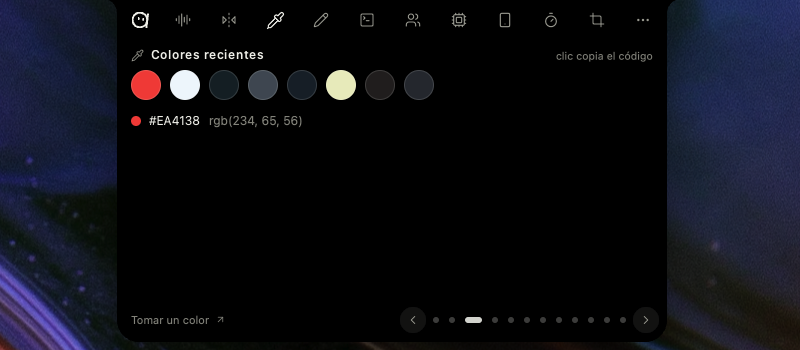

An eyedropper to pick colors from the screen (0.4.28).

- A 13×13 pixel loupe follows the cursor. Click or `Enter` copies the color and closes. Arrow keys move the
  cursor 1 px (`Shift`: 10) so you can land on the exact pixel.
- `Tab` switches the format: HEX, RGB or HSL. `R` opens the color rose: a saturation and brightness square,
  hue, HEX and recent colors.
- Copied colors show up in the [Clipboard](#clipboard) history and in the tool's peek.
- **Opens:** `Alt+C` · `⌘⇧C`, the wheel or the launcher. It works on every display.

### Flip

The front window flips over and a board for notes appears behind it.

- The board is a continuous sheet of up to 10 pages with text, checklists, images and freehand drawing. It
  saves itself and you can see it from any window.
- Insert from the clipboard, Texts or Captures; paste with `Ctrl+V` or drag images in. **Import meetings**
  with their summary and tasks as checkboxes (0.4.47).
- Tools: pen, highlighter, eraser, text, list, move and hand. Zoom and pan, box selection, undo and redo.
- **Export** to PNG, JPEG, PDF, Word or PowerPoint, one page per sheet; images come as a `.zip` when there are
  several.
- **Opens:** `Alt+B` · `⌘⇧B`, or the wheel. The same shortcut, `Esc` or «Back» closes it. If the computer is
  too busy, the flip is cancelled and your window stays where it was.

### Now playing

Whatever any app reports to the system as playing (Spotify, the browser with YouTube…).

- Cover art, title and artist; play and pause, previous and next, ±10 s and a draggable progress bar.
- System volume and per-app volume, and choosing the audio output.
- **Synced lyrics** for the track (from LRCLIB; only title, artist and duration are sent). They hang from the
  notch and can be turned off in Settings → Pill.
- The tab shows the cover and a wave driven by the real audio level. When paused, the cover stays dimmed with
  a ▶ for 10 minutes so you can resume.
- The peek transforms into the panel (0.4.50), and the panel unfolds from the cover with scroll (0.4.49).
- **Opens:** the wheel or the cover on the tab; no shortcut. Also in the launcher («Music»).
- **Windows:** reads the system media session. **Mac:** reads MediaRemote through `osascript`.

### Phone

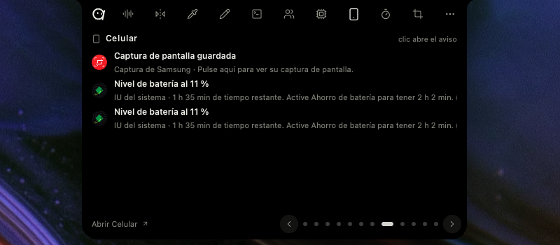

Connects your PC with the **Atic app for Android**. It is end-to-end encrypted, with no accounts and no Atic
cloud. You link it in **Settings → Phone** with a QR code (0.4.46); on the same network, phone and PC find
each other automatically (0.5.0).

- Shared clipboard in both directions; anything a password manager marks as sensitive is not sent.
- Phone notifications on the pill, with replies, and **calls**: who is calling, answer or hang up.
- Files, links and photos between the two; ask for a **photo with the phone's camera** that lands on the PC
  clipboard; make the **phone ring** to find it.
- PC music, and watching and answering agents from the phone, including their permissions. Stop a Meetings
  recording from there.
- **Phone screen on the PC** (0.5.3), in a window, view-only or with control; and **the PC screen on the
  phone** with absolute touch (0.5.3, 0.5.5).
- Chat and buzzes between two linked Atic installs (0.5.4).
- Two permissions are turned on deliberately in Settings → Phone: **Write to agents** and **Control this PC**
  (volume, lock, slides, touchpad and keyboard, viewing the PC screen).
- **Opens:** the wheel («Phone») shows the notices; the notch tray announces calls and access requests.

### Pomodoro

Focus rounds with breaks (0.5.1).

- Defaults: 25 min of focus, 5 of short break and a 15-minute long break every four focus rounds. Everything
  is adjustable in its panel.
- The panel shows the ring with the time, the modes (Focus, Short break, Long break), start, pause and resume,
  and what you focused on today.
- Options: let the next round start by itself, and play a sound when it ends. A system notification arrives
  when a round ends.
- While running, the time shows on the resting tab. It follows the system clock: if the pill lags, the
  Pomodoro does not.
- **Opens:** the wheel; no shortcut.

### Apps, launcher, calculator and emoji

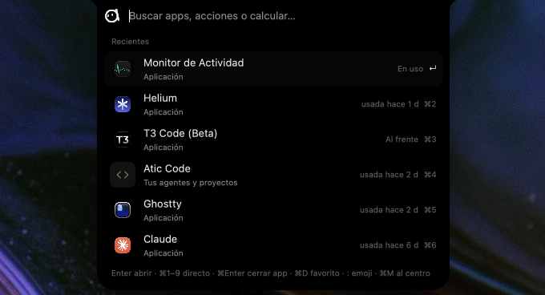

A Spotlight-style search: the notch strip is the field.

- Opens **apps** (Start menu and Store apps on Windows; system apps, icons and Recents on Mac) and
  **actions**: capture, Board, Color, Clipboard, Texts, Flip, copy text from the screen, record a meeting,
  Music, Volume and brightness, Settings, Atic Code, dark mode, mute, lock, sleep and empty the trash.
- **Favorites** (up to 8) as little bubbles at the end of the bar, with `Ctrl+D`; `Ctrl+1`–`9` opens directly
  and `Ctrl+M` moves it to the center of the screen. `Ctrl+Enter` quits the selected app (0.4.34) or opens a
  recent folder in your editor.
- **Calculator** (0.4.34): arithmetic, units (length, mass, volume, area, speed, time, data) and time zones
  («15:00 chile en madrid»). `Enter` copies the result.
- **Currencies** (0.4.41, opt-in in Settings → Launcher): «30,000 CLP to UF», «30 USD to CLP». It queries
  mindicador.cl and exchangerate-api.com, shows the rate's date and does not send what you type.
- **Emoji:** `:` on an empty bar opens the catalog, with search in Spanish and English and skin tones; `Enter`
  pastes and `Ctrl+Enter` copies.
- **Opens:** `Alt+Shift+Space` · `⌘⇧Space`.

### Notices tray

What is waiting for your attention, inside the notch and with no separate windows.

- **Agents:** a finished turn (*to review*) or a permission request (*decision*). Counters beside the pill's
  mark show how many agents are working and how many are waiting. A permission is answered right there.
- **Phone:** notifications, calls (answer or hang up) and requests from the phone to control the PC or write
  to your agents.
- **Updates:** «Atic X available», which installs itself and reopens the pill. **What's New** shows what
  changed, the first time after updating and from the tray menu.
- **Icon menu** (system tray on Windows, menu bar on Mac): Settings, Capture screen, Meetings, Atic Code,
  What's New and Quit.

## Settings

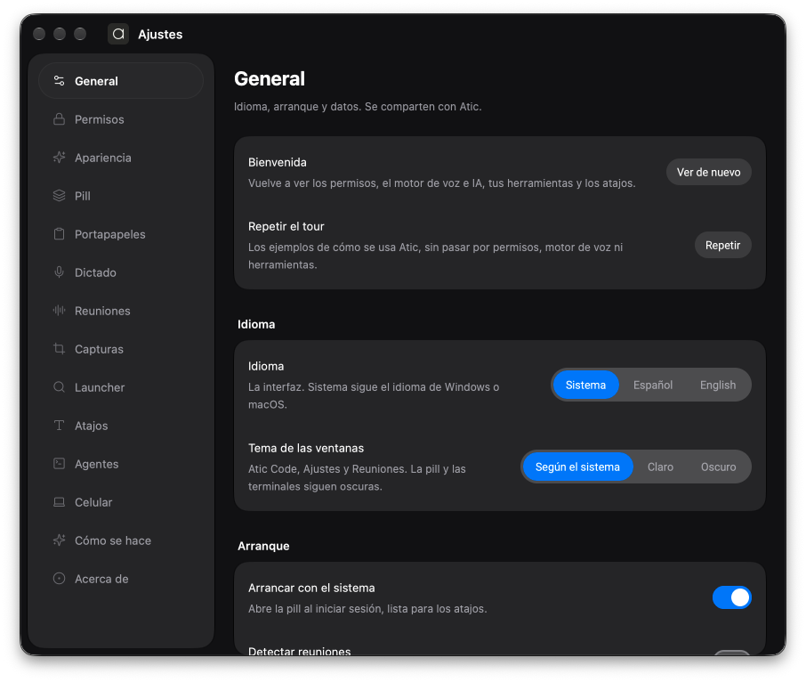

Opens with a click on the pill's little face, from the tray, or from the launcher.

- Sections: General, Appearance, Pill, Clipboard, Dictation, Meetings, Captures, Launcher, Shortcuts, Agents,
  Phone, Permissions (macOS), How-tos and About.
- **Appearance:** light, dark or system theme; window style (Atic, Material 3 Expressive or Liquid Glass on
  macOS 26); the pill's color and transparency.
- **Language:** Spanish or English (0.5.0), or the system's.
- **How-tos** replays the guided tour; **Welcome** asks for permissions, the speech engine and your tools.
- **About:** checks for updates (on launch and every 6 hours); installing downloads, verifies the signature
  and restarts.
- **Permissions (macOS):** Accessibility, Input Monitoring, Screen Recording, Microphone and System Audio,
  with their status and a button to request them. Details in [`MACOS.md`](MACOS.md).

## Privacy

Recordings, transcripts, history and agent conversations live on your disk. Keys (Groq, Claude, OpenAI…) and
the SMTP password go to the system keychain. The local model (Parakeet) and the macOS voice transcribe on your
computer; Groq and the summary providers receive only what you choose to use (the audio, if you transcribe
with Groq; the text, when summarizing). There is no Atic account and no product telemetry.
